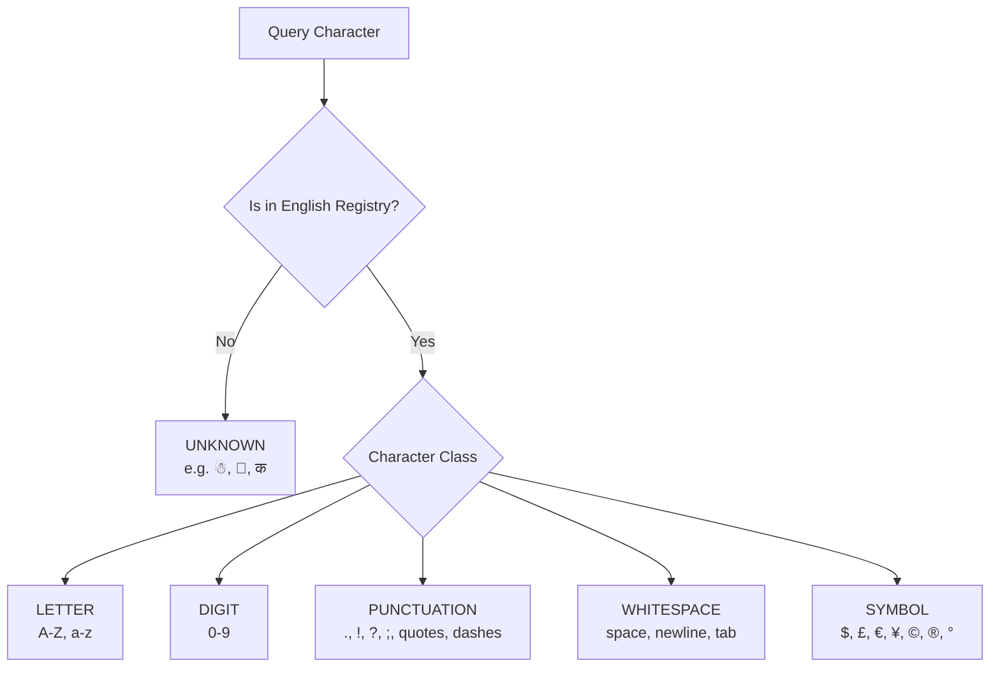

# VEDA Character Knowledge Layer v0.1
*Component: Character Knowledge (Phase 1 — English Character Foundation)*

```
VEDA Architecture Flow:
Character Registry  ──►  Character Knowledge  ──►  Character Tokenizer  ──►  Model Architecture
 ("How to represent")        ("What it is")           ("How to index")         ("How to learn")
```

---

## 1. What Character Knowledge Is
The **VEDA Character Knowledge Layer v0.1** is a symbolic, structured knowledge subsystem that answers the question:
> **"What is this character?"**

While the [Character Registry](file:///c:/Users/karnik%20YOGA/OneDrive/Desktop/veda/foundation/characters/registry.py#L59) defines which symbols are in VEDA's English inventory, and the [Character Tokenizer](file:///c:/Users/karnik%20YOGA/OneDrive/Desktop/veda/tokenizer/char_tokenizer.py#L35) maps symbols to discrete integer token IDs, the **Character Knowledge Layer** provides rich, programmatic semantic understanding of each character's identity, linguistic type, case relationships, alphabet position, phonetic name, and curated usage examples.

---

## 2. Why It Exists
In first-principles language model research, jumping directly from character glyphs to opaque embedding vectors obscures fundamental linguistic symmetries:
- In English, `'A'` and `'a'` share identical alphabet position (1), identical letter name, and semantic equivalence under case folding, while differing in case syntax and Unicode encoding.
- Digits (`'0'..'9'`) share numeric properties that differ categorically from punctuation (`'!'`, `'.'`) and whitespace (`' '`, `'\n'`).
- Control characters and special tokens (`<PAD>`, `<UNK>`, `<BOS>`, `<EOS>`) are system abstractions, not linguistic graphemes.

By explicitly structuring character knowledge before neural weight training, VEDA establishes a verifiable, symbolic foundation that directly informs:
1. Future subword tokenization merges.
2. Lexicon validation and dictionary construction.
3. Quality filtering in the corpus pipeline.
4. Model inspection and interpretability.

---

## 3. Difference Between Registry and Knowledge

| Dimension | Character Registry (`registry.py`) | Character Knowledge Base (`knowledge.py`) | Character Tokenizer (`char_tokenizer.py`) |
|---|---|---|---|
| **Core Question** | *"How do I represent this character?"* | *"What is this character?"* | *"How do I index this sequence?"* |
| **Primary Unit** | [CharacterEntry](file:///c:/Users/karnik%20YOGA/OneDrive/Desktop/veda/foundation/characters/registry.py#L32) | [CharacterKnowledgeEntry](file:///c:/Users/karnik%20YOGA/OneDrive/Desktop/veda/foundation/characters/schemas.py#L54) | Integer Token IDs (`0..116`) |
| **Special Tokens** | Contains `<PAD>`, `<UNK>`, `<BOS>`, `<EOS>` | Separate from character knowledge | Assigned IDs `0..3` |
| **Scope** | Controlled English character inventory | Semantic & linguistic properties | Bijective sequence encoding/decoding |
| **Unknown Behavior** | Unregistered | Returns safe `known=False`, `type='unknown'` | Maps to `<UNK>` (ID 1) |

---

## 4. Character Classification
Every character queried through the knowledge layer is categorized into one of six mutually exclusive types:



- **LETTER**: English alphabetic characters (26 uppercase, 26 lowercase).
- **DIGIT**: Standard decimal numeric digits (`0` through `9`).
- **PUNCTUATION**: Sentence boundaries, pauses, brackets, quotation marks (`.`, `!`, `?`, `,`, `-`, `“`, `”`, `—`, etc.).
- **WHITESPACE**: Delimiters and structural breaks (` `, `\t`, `\n`, `\xa0`).
- **SYMBOL**: Mathematical, commercial, currency, and typographical symbols (`$`, `£`, `€`, `¥`, `©`, `®`, `°`, `•`, `·`).
- **UNKNOWN**: Any character outside the English registry (e.g. snowman `☃`, emojis, non-English scripts).

---

## 5. Unicode Metadata
Rather than hardcoding static metadata, Unicode attributes are programmatically derived using Python's standard library `unicodedata` module:
- **Unicode Codepoint**: Hexadecimal string formatted as `U+XXXX` (e.g., `ord('A')` $\to$ `U+0041`).
- **Unicode Name**: Formal character designation from the Unicode character database (e.g. `LATIN CAPITAL LETTER A`, `EXCLAMATION MARK`).
- **Unicode Category**: General Unicode category (e.g. `Lu` for uppercase letter, `Ll` for lowercase letter, `Nd` for decimal digit, `Po` for other punctuation, `Zs` for space separator).
- **Provenance**: Tracked against the active Unicode standard version (`Unicode Standard {unicodedata.unidata_version}`).

---

## 6. Uppercase / Lowercase Relationships
The knowledge layer maintains bidirectional case relationships:
- For uppercase letters: `get_lowercase("A")` returns `"a"`.
- For lowercase letters: `get_uppercase("a")` returns `"A"`.
- For non-letters (digits, punctuation, symbols): returns `None`.

These relationships are derived programmatically via `char.lower()` and `char.upper()` and validated against registry entries.

---

## 7. Alphabet Positions
For the 26 letters of the English alphabet, positions are strictly mapped from 1 to 26:
$$\text{Position}(c) = \text{ord}(\text{upper}(c)) - \text{ord}('A') + 1$$

Examples:
- `'A'` $\to 1$, `'a'` $\to 1$
- `'M'` $\to 13$, `'m'` $\to 13$
- `'Z'` $\to 26$, `'z'` $\to 26$

For any non-letter character (digits, punctuation, whitespace, symbols, and unknowns), `get_alphabet_position(char)` returns `None` rather than fabricating an artificial ordinal.

---

## 8. Unknown Characters
Robustness is guaranteed when encountering out-of-scope characters:
- Querying an unknown character (e.g. `'☃'` or `'🤖'`) returns a safe `CharacterKnowledgeEntry` where:
  ```json
  {
    "character": "☃",
    "known": false,
    "type": "unknown",
    "case": null,
    "alphabet_position": null,
    "unicode": "U+2603"
  }
  ```
- The system never raises unhandled exceptions.
- It never falsely classifies foreign or unlisted characters as English letters.

---

## 9. How the Tokenizer Uses This Layer
The Character Knowledge Layer and Character Tokenizer share the exact same underlying Character Registry:
- Character `'A'`:
  - **Knowledge**: Uppercase letter, alphabet position 1, lowercase counterpart `'a'`, Unicode `U+0041`.
  - **Registry**: Character ID 33.
  - **Tokenizer**: Token ID 37 (offset by 4 special tokens).
- When tokenizing, characters verified as `known=True` are indexed with their dedicated token ID.
- Characters with `known=False` are mapped by the tokenizer to `<UNK>` (Token ID 1).
- Cross-layer coherence is verified by automated round-trip tests in [tests/test_character_knowledge.py](file:///c:/Users/karnik%20YOGA/OneDrive/Desktop/veda/tests/test_character_knowledge.py).

---

## 10. Current Limitations
1. **English Scope Only**: v0.1 only recognizes the 113 English-oriented characters in `veda_characters_v0.1.json`. Characters from other writing systems (Devanagari, Cyrillic, Arabic, Chinese) are classified as `known=False` / `type='unknown'`.
2. **Curated Examples**: Example words for letters are curated for foundational testing (3 words per letter) and do not represent a full dictionary. Full vocabulary coverage will arrive in Phase 3 (Lexical Foundation).

---

## 11. Future Evolution
1. **Phase 1 Character Normalization**: Building normalization rules (NFKC/NFD, smart quote folding, case folding) using the knowledge layer's case and category metadata.
2. **Phase 2 Subword Merging**: Utilizing letter frequency and bigram statistics informed by character knowledge.
3. **Phase 3 English Lexical Foundation**: Linking character knowledge directly to dictionary headwords, phonetic transcriptions, and Wiktionary glosses.
4. **Multilingual Expansion (Future v1.x)**: Extending character knowledge schemas to multi-script registries (Hindi, Sanskrit, Punjabi) with script-specific alphabetic positions and phonetic articulatory features.
