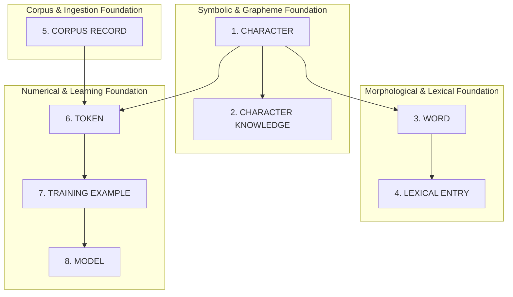

# VEDA Data Contracts & Architectural Boundaries

```
========================================================================================
VEDA — "From Knowledge to Intelligence"
Foundational Architectural Specification: Data Contracts & Layer Boundaries
========================================================================================
```

## 1. Core Principle: Strict Boundary Enforcement

In first-principles language model architecture, conflating structural units, dictionary entries, token indices, and neural representations leads to architectural rot and scalability failures.

VEDA strictly separates **eight foundational layers**:



### Layer Definitions & Invariant Boundaries

| Layer | Formal Definition | Primary Data Structure | Prohibited Anti-Patterns (Must NOT Happen) |
|---|---|---|---|
| **1. CHARACTER** | A representable symbol in VEDA's character inventory. | `CharacterEntry` (`registry.py`) | Must not contain tokenization logic or dictionary definitions. |
| **2. CHARACTER KNOWLEDGE** | Structured symbolic information describing a single character (Unicode, phonetic, case, position). | `CharacterKnowledgeEntry` (`knowledge.py`) | Must not define neural embeddings or token sequences. |
| **3. WORD** | A normalized lexical/morphological word object maintaining surface form, canonical lowercase identity, and constituent characters. | `Word` (`word.py`) | **A Word object must NOT become a giant dictionary record.** Lexical data remains optional/referenced. |
| **4. LEXICAL ENTRY** | Dictionary knowledge associated with a lexical item (definitions, POS, pronunciations, inflections, senses, etymology). | `LexicalEntry` (`schemas.py`) | **A LexicalEntry must NOT become a neural model representation.** It contains human lexicographical knowledge, not learned vectors. |
| **5. CORPUS RECORD** | Natural language running discourse or document used for language-model training. | `CorpusRecord` (Phase 4) | Must not be confused with dictionary definitions. The Lexicon is NOT the training corpus. |
| **6. TOKEN** | A discrete integer input unit produced by a tokenizer. | `int` (Token ID) | Token IDs represent indexed vocabulary symbols, not grammatical concepts. |
| **7. TRAINING EXAMPLE** | A model-ready input/target tensor pair (e.g., causal autoregressive sequences $(x_{1:T}, y_{2:T+1})$). | Numerical tensor / batch array | Must be strictly decoupled from dictionary structures. |
| **8. MODEL** | A neural system that learns parameter weights from training data. | Neural network parameters | Operates strictly on numerical tokens and tensor representations. |

### Critical Architectural Separations
1. **Word vs LexicalEntry**: A `Word` maintains morphological and graphemic identity (`original`, `normalized`, `characters`, `character_ids`). A `LexicalEntry` holds lexicographical dictionary knowledge.
2. **Lexicon vs Tokenizer**: The `Lexicon` is a semantic repository. The `CharacterTokenizer` is a discrete sequence encoder/decoder. **The Lexicon must NOT become the tokenizer.**
3. **Tokenizer vs Dictionary**: The `CharacterTokenizer` must **never** contain dictionary definitions or part-of-speech lookups.

---

## 2. Character Registry $\longleftrightarrow$ Word $\longleftrightarrow$ Lexicon Contract

The relationship between the Character Registry, the Word Foundation, and the Lexicon flows deterministically:

$$\text{Character Registry} \longrightarrow \text{Word Foundation} \longrightarrow \text{Lexicon}$$

### Contract Rules:
1. **Explicit Support Evaluation**: The Lexicon must never silently assume that every character appearing in a lexical entry is supported by the Character Registry.
2. **Four-Way Lexical Status**: For any given query or headword, the system can distinguish:
   - **Lexical Entry Existence**: Does a dictionary entry exist in the Lexicon? (`lexicon.has_word(text)`)
   - **Orthographic Candidate Status**: Does it satisfy v0.1 plain English candidate rules? (`analyzer.is_word_candidate(text)`)
   - **Character Representability**: Are all constituent characters supported by the Character Registry? (`word.is_representable` / `entry.is_representable()`)
   - **Unsupported Characters**: Exact list of unsupported Unicode characters (`word.unsupported_characters` / `entry.unsupported_characters()`)
3. **No Silent Mutation to `<UNK>`**:
   - `<UNK>` is strictly a **tokenizer-level sequence mapping abstraction**.
   - The lexical data model and Word representation preserve the exact Unicode characters (e.g. `'café'` retains `'é'`).
   - Unsupported characters must **never** be silently converted into `<UNK>` during lexical parsing, normalization, or validation.

---

## 3. Tokenizer Roadmap & `<UNK>` Semantics

### Reference vs Future Tokenizers
- **Reference Tokenizer (Current v0.1)**: `CharacterTokenizer` (`tokenizer/char_tokenizer.py`).
  - Vocabulary: Exactly 117 tokens (4 special control tokens + 113 English-oriented characters).
  - Character Inventory: 113 registered characters composed of 95 standard printable ASCII characters (`0x20` to `0x7E`) and 18 essential typography/whitespace characters (`\t`, `\n`, `\r`, NBSP, `‘’`, `“”`, `–`, `—`, `…`, `•`, `£€¥`, `©®`, `°±×÷`).
  - Guarantees exact bijection and lossless roundtrip for all registered symbols.
- **Future Tokenizer Roadmap**:
  - Phase 2/4 will explore byte-pair encoding (BPE), subword tokenization, or byte-fallback tokenizers trained on VEDA's own corpus and lexicon.
  - The character tokenizer will remain the permanent foundational reference tokenizer for verification and low-level character inspection.

### Semantic Definition of `<UNK>`
- **`<UNK>` Token (ID 1)**: The discrete token ID assigned by the tokenizer when encountering an out-of-vocabulary character that cannot be represented in the active tokenization vocabulary.
- **`<UNK>` is NOT an Unknown Lexical Word**:
  - The string `"blork"` is an alphabetically valid candidate word absent from the Lexicon. It encodes into 5 valid token IDs (`[68, 78, 81, 84, 77]`) with **zero** `<UNK>` tokens.
  - Conversely, an unsupported Unicode glyph (such as `☃` or `😊`) produces `<UNK>` in the tokenizer, while the lexical layer preserves the original character.

---

## 4. Lexicon $\neq$ Training Corpus

A foundational error in NLP is assuming dictionary definitions alone constitute an adequate training corpus for a generative language model.

```
Wiktextract / Dictionaries  ──►  Lexical Knowledge Base  ──►  Structured Constraints, Lexical Analysis
General Text Discourse      ──►  English Corpus Pipeline  ──►  Pretraining Training Examples
```

### Why Dictionary $\neq$ Corpus:
1. **Linguistic Distribution**: Natural language consists of running discourse, dialogue, narratives, pragmatic context, syntax trees, and logical transitions. Dictionaries consist of isolated, formal lexicographical definitions.
2. **Attention Dynamics**: Causal language models learn next-token statistical dependencies across multi-paragraph documents. Dictionary glosses lack natural document-level co-occurrence.
3. **Role of the Lexicon**: In VEDA, the Lexicon serves as an authoritative ground truth for vocabulary verification, morphological analysis, POS validation, and downstream structured evaluation—**not** the primary pretraining text corpus.

---

## 5. Provenance, Versioning, and Reproducibility

Every derived artifact generated in VEDA must be deterministic and fully traceable.

### Reproducibility Equation
$$\text{Raw Source Data} + \text{Code Version} + \text{Processing Configuration} = \text{Identical Derived Artifact}$$

### Metadata Contract (`LexiconMetadata`)
Every serialized Lexicon contains:
- `project`: Project identity (`"VEDA"`)
- `component`: Component identity (`"Lexical Foundation"`)
- `version`: Lexicon version (`"0.1.0"`)
- `schema_version`: Data model schema version (`"0.1.0"`)
- `extractor_version`: Extractor engine version (`"0.1.0"`)
- `normalization_version`: Normalization policy version (`"0.1.0"`)
- `source_dataset`: Source file or origin (`"Wiktionary (Wiktextract)"`)
- `created_at`: ISO-8601 UTC timestamp of extraction
- `processing_config`: Exact extraction parameters (`max_lines`, `validate_candidates`, etc.)
- `word_count`: Number of unique entries
- `pos_distribution`: Grammatical category frequencies

### Entry-Level Provenance (`LexicalEntry.provenance`)
Each dictionary entry records:
- `source_dataset`: Dataset name
- `extractor_version`: Extractor version that created the entry
- `source_lang`: Original source language field (`"English"`)
- `source_lang_code`: Original source language code (`"en"`)

---

## 6. Streaming Input vs In-Memory Output Memory Contract

### Precision of Terminology
- **Streaming Input Parser**: Reads raw input files line-by-line using a fixed-size buffer ($O(1)$ stream memory overhead). It never invokes `readlines()`, `list(f)`, or monolithic `json.load()` on multi-gigabyte files.
- **In-Memory Aggregated Output**: Consolidating millions of dictionary entries into a hash map requires memory strictly proportional to the number of distinct words ($O(V)$ where $V$ is vocabulary size).

> **Contract Rule**: VEDA documentation and code must never claim "$O(1)$ memory for the entire pipeline" when aggregating full dictionaries in RAM. It must accurately distinguish streaming input from in-memory aggregation.
