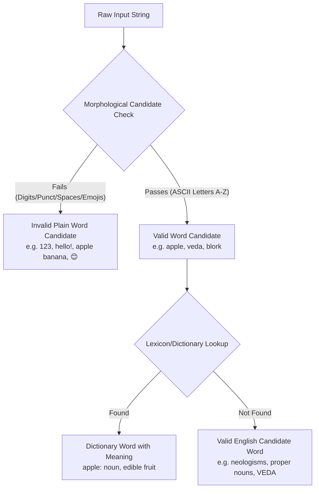

# VEDA Word Foundation v0.1
*Component: Word Foundation (Phase 2 — From Characters to Words)*

```
VEDA Multi-Layer Architecture:
Character Registry  ──►  Character Knowledge  ──►  Word Foundation  ──►  Lexicon  ──►  Tokenizer / Model
 ("Represent Symbol")    ("Understand Symbol")     ("Compose Words")   ("Define Meaning")  ("Tokenize & Learn")
```

---

## 1. What a VEDA Word Is
In the VEDA architecture, a **Word** is a structured linguistic entity formed by a deterministic sequence of registered characters. It serves as the bridge between low-level character graphemes and high-level lexical definitions.

A VEDA [Word](file:///c:/Users/karnik%20YOGA/OneDrive/Desktop/veda/foundation/words/word.py#L17) maintains:
- **Surface Form (`original`)**: The exact string as extracted or typed (e.g., `"Apple"`, `"VEDA"`).
- **Lexical Identity (`normalized`)**: The canonical lowercase, whitespace-trimmed form (e.g., `"apple"`, `"veda"`).
- **Character Decomposition (`characters`)**: The ordered list of individual constituent characters (`['a', 'p', 'p', 'l', 'e']`).
- **Character IDs (`character_ids`)**: The exact serial indices of its constituent characters in the [CharacterRegistry](file:///c:/Users/karnik%20YOGA/OneDrive/Desktop/veda/foundation/characters/registry.py#L59) (`[67, 82, 82, 78, 71]`).
- **Length (`length`)**: The character length of the word ($N_\text{chars} = 5$).

---

## 2. Difference Between Word Candidate and Dictionary Word

It is critical in first-principles language modeling to keep **morphological structure** separate from **lexicon membership**:



- **Word Candidate**: A string that structurally conforms to English orthographic constraints (for v0.1: a non-empty sequence of purely alphabetic ASCII letters). For example, `"apple"`, `"veda"`, and `"blork"` are all valid English word candidates.
- **Dictionary Word**: A word candidate that is verified to exist in an authoritative English lexicon (such as Wiktionary) with associated parts of speech, glosses, and etymology. Membership in a dictionary is handled downstream in **Phase 3 (Lexicon)**.

---

## 3. Normalization Policy
English text exhibits surface-level orthographic variations:
- Leading and trailing whitespace (e.g., `"  apple \n"`)
- Case variations (e.g., `"apple"`, `"Apple"`, `"APPLE"`)

**VEDA v0.1 Normalization Policy**:
1. Strip all leading and trailing whitespace characters.
2. Case-fold all characters to lowercase using standard Unicode case mapping.
3. Preserve the original untampered string in `word.original`.
4. Store the canonical representation in `word.normalized`.

---

## 4. Character Integration
The Word Foundation does **not** create an independent character table. It directly queries the canonical [CharacterRegistry](file:///c:/Users/karnik%20YOGA/OneDrive/Desktop/veda/foundation/characters/registry.py#L59) and [CharacterKnowledge](file:///c:/Users/karnik%20YOGA/OneDrive/Desktop/veda/foundation/characters/knowledge.py#L18):
- Every character in `word.characters` references the exact single Unicode character defined in `veda_characters_v0.1.json`.
- There is only **one single source of truth** for character identity across the entire VEDA project.

---

## 5. Word $\longrightarrow$ Character IDs
The [WordAnalyzer](file:///c:/Users/karnik%20YOGA/OneDrive/Desktop/veda/foundation/words/analyzer.py#L18) provides `get_character_ids(word)` and `encode_word(word)`:

$$\text{"apple"} \longrightarrow \begin{bmatrix} \text{'a'} \\ \text{'p'} \\ \text{'p'} \\ \text{'l'} \\ \text{'e'} \end{bmatrix} \longrightarrow \begin{bmatrix} \text{id} = 67 \\ \text{id} = 82 \\ \text{id} = 82 \\ \text{id} = 78 \\ \text{id} = 71 \end{bmatrix}$$

This produces the foundational bridge:
$$\text{Word} \longrightarrow \text{Character System} \longrightarrow \text{Tokenizer Token IDs}$$

---

## 6. Reverse Operation (Character IDs $\longrightarrow$ Word)
The reverse transformation is implemented via `decode_word(character_ids)`:

$$\begin{bmatrix} 67, 82, 82, 78, 71 \end{bmatrix} \longrightarrow \begin{bmatrix} \text{'a'}, \text{'p'}, \text{'p'}, \text{'l'}, \text{'e'} \end{bmatrix} \longrightarrow \text{Word("apple")}$$

The critical round-trip invariant is enforced and verified across all test cases:
$$\text{decode\_word}(\text{encode\_word}(w)) == w.\text{normalized}$$

---

## 7. Case Handling & Word Identity
In VEDA:
- Two word instances are **lexically identical** if their normalized forms match:
  $$\text{Word}("Apple") == \text{Word}("apple") == \text{Word}("APPLE")$$
- Hashing uses the normalized representation: `hash(word) == hash(word.normalized)`. This allows deduplicating vocabularies in sets and dictionaries without losing case information when inspecting specific occurrences.
- Exact surface match can be queried explicitly via `word.exact_match(other)`.

---

## 8. Future Lexicon Integration (Phase 3)
The [WordSchema](file:///c:/Users/karnik%20YOGA/OneDrive/Desktop/veda/foundation/words/schemas.py#L42) reserves modular slots for Phase 3:
```json
{
  "word": "apple",
  "normalized": "apple",
  "language": "en",
  "characters": ["a", "p", "p", "l", "e"],
  "character_ids": [67, 82, 82, 78, 71],
  "length": 5,
  "lexical": {
    "part_of_speech": "noun",
    "definitions": ["A common, round fruit produced by the tree Malus domestica..."],
    "synonyms": [],
    "antonyms": []
  },
  "forms": ["apples", "apple's"],
  "sources": ["Wiktionary"]
}
```
When the streaming importer reads `veda_sample.jsonl` (and eventually the full dataset), it will instantiate `Word` objects via `WordAnalyzer.create_word()`, validate candidates, and populate `lexical` definitions cleanly without refactoring.

---

## 9. Current Limitations
1. **Plain Words Only**: v0.1 validates plain single-token alphabetic words. Compound words with hyphens (`state-of-the-art`) or internal apostrophes (`don't`) are flagged for Phase 3 token segmentation.
2. **English Scope**: Words containing accented letters (`café`, `naïve`) or non-English scripts (`नमस्ते`) are classified as non-English candidates.
3. **Controlled Development Vocabulary**: Currently seeded with 16 representative words in `data/words/veda_words_v0.1.json` before full Wiktionary batch processing.
