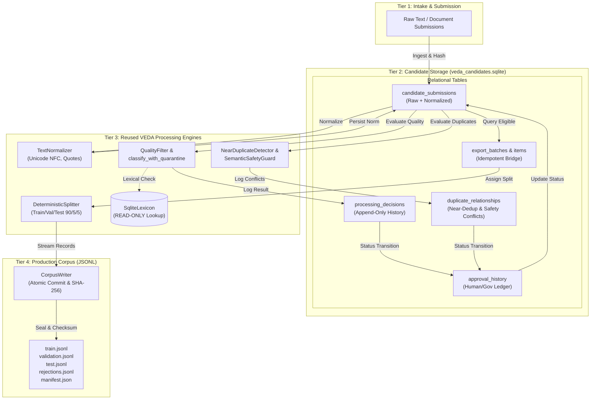
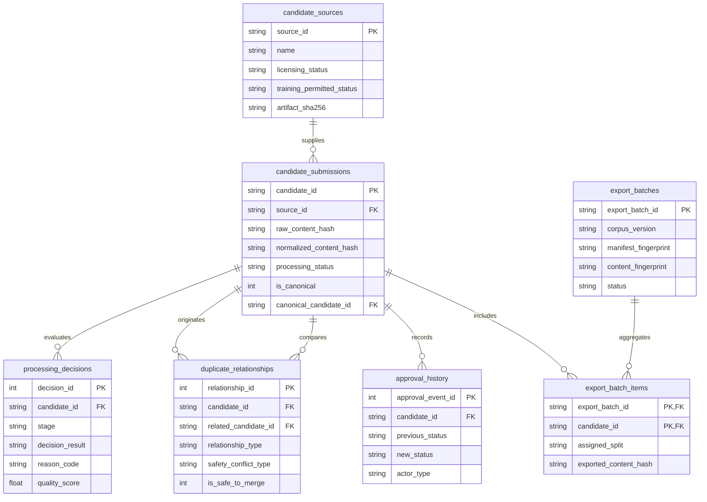
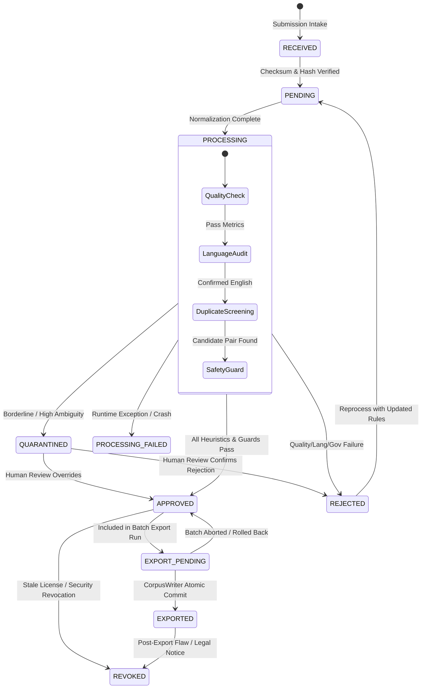
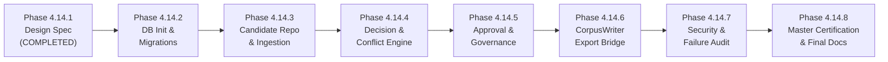
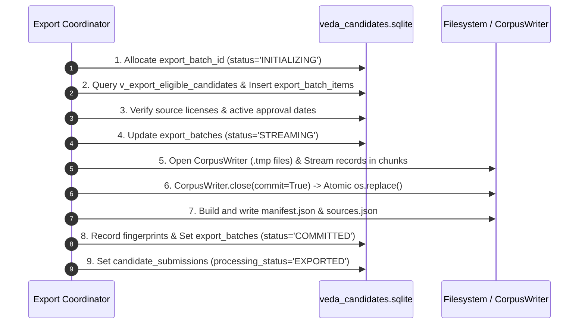
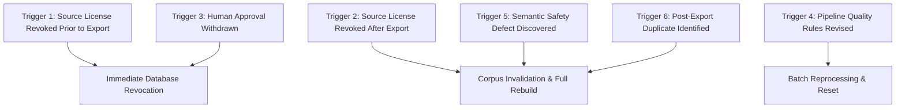
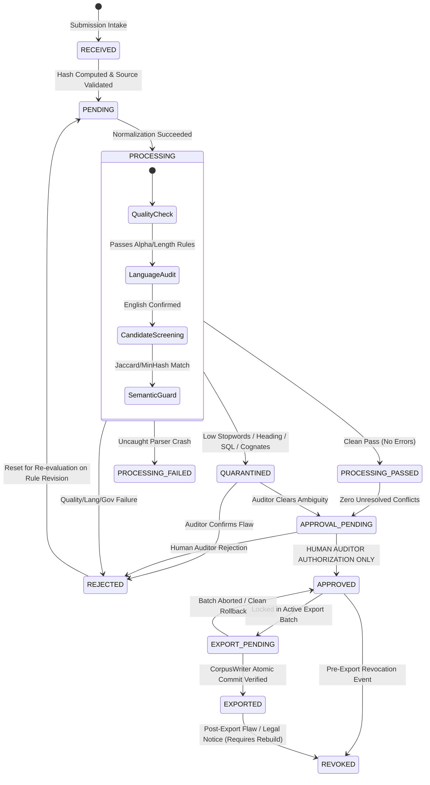
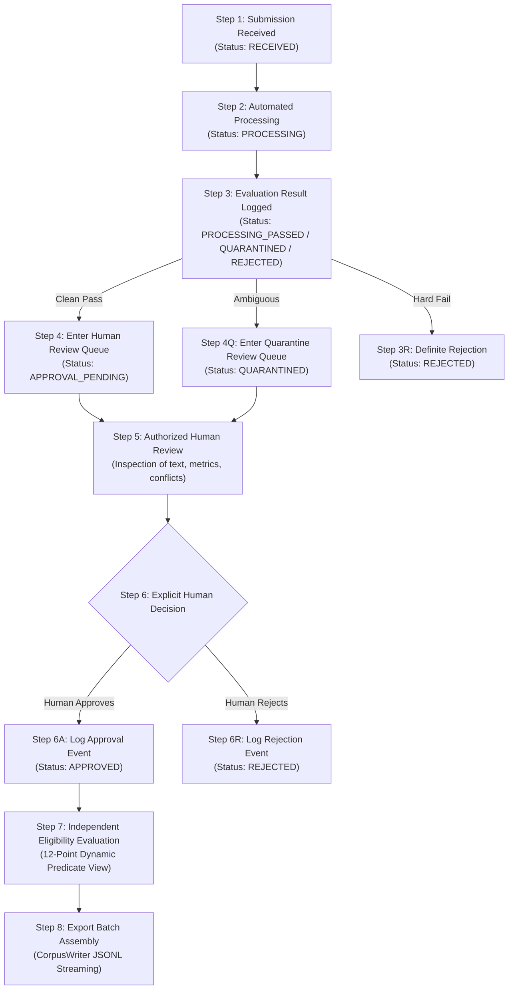
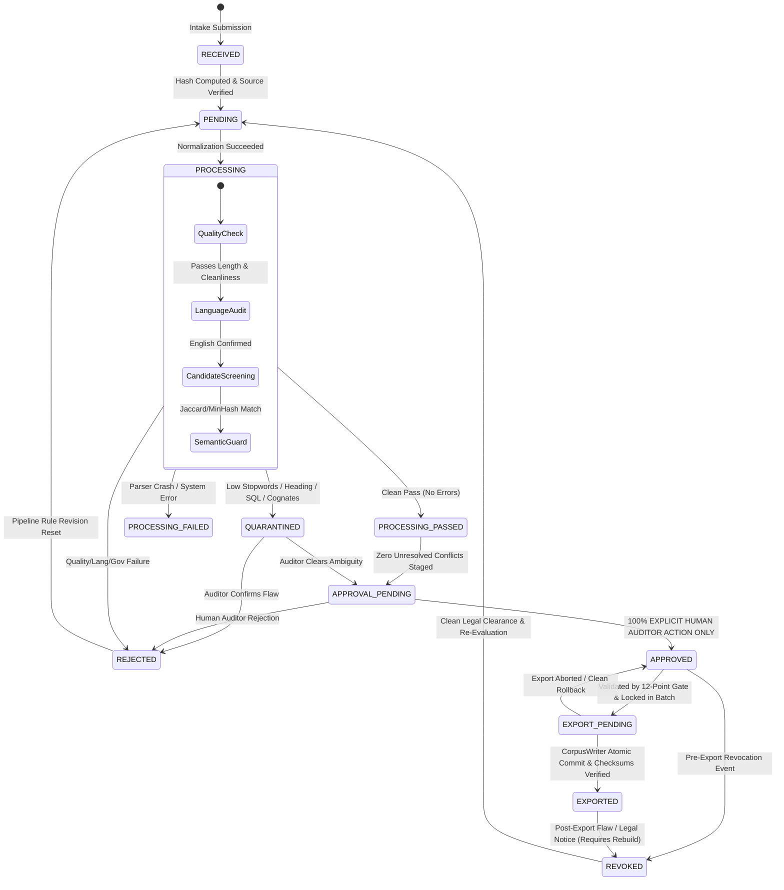

# VEDA Phase 4.14.1 Engineering Specification
## Database-Backed Candidate & Decision Storage Architecture Design

- **Project:** VEDA — From Knowledge to Intelligence
- **Phase:** 4.14.1 (Design Specification Only)
- **Status:** COMPLETE / READY FOR REVIEW
- **Author:** Antigravity (Cognitive Architecture Agent)
- **Date:** 2026-11-13
- **Git Base Checkpoint:** `2928dcb7030a202e6ebd5c5370984d78c63fe77c` (main)
- **Runtime Targets:** Python 3.14.8 (`.venv`) & Python 3.9.13 (Global System)
- **Pretraining Status:** Strictly PAUSED / BLOCKED

---

## 1. Executive Summary

### 1.1 Mission & Scope
Phase 4.14.1 defines the architectural blueprint and relational database specification for Project VEDA's **Candidate & Decision Storage Architecture** (`veda_candidates.sqlite`). 

Under the core philosophy of VEDA (*Understand → Implement → Test → Measure → Document → Improve*), this phase is **strictly design-only**. No production Python source code is modified, no live database tables are created, no schema migrations are executed, and no training pretraining runs are initialized.

### 1.2 The Three Storage Pillars
The VEDA storage topology is explicitly partitioned into three non-interchangeable systems:

```
┌─────────────────────────────────────────────────────────────────────────────┐
│                            VEDA STORAGE TOPOLOGY                            │
├─────────────────────────────────────────────────────────────────────────────┤
│  PILLAR 1: English Lexicon (Phase 3)                                        │
│  - Engine: SQLite (data/lexicon/veda_lexicon_v0.1.sqlite)                   │
│  - Scope: 959,688 words, lemmas, definitions, POS, pronunciations.          │
│  - Mode: Strictly READ-ONLY during candidate and corpus processing.         │
├─────────────────────────────────────────────────────────────────────────────┤
│  PILLAR 2: Candidate & Decision Storage (Phase 4.14 — THIS DESIGN)          │
│  - Engine: SQLite (data/candidates/veda_candidates.sqlite)                  │
│  - Scope: Submissions, verbatim raw text, normalized text, decisions,       │
│           semantic conflicts, duplicate graphs, approval ledger.            │
│  - Mode: ACID Read/Write, append-mostly audit journal.                      │
├─────────────────────────────────────────────────────────────────────────────┤
│  PILLAR 3: Training Corpus (Phase 4)                                        │
│  - Engine: Streaming atomic JSONL (data/corpus/{train,validation,test}.jsonl│
│  - Scope: Sealed splits, cryptographic manifests, tokenization input.       │
│  - Mode: Append-only releases sealed by cryptographic hashes.               │
└─────────────────────────────────────────────────────────────────────────────┘
```

### 1.3 Core Invariants
1. **Verbatim Fidelity:** Original submitted text is immutable and never overwritten or lossy-compressed.
2. **Normalized Derivation:** Normalized text is deterministically derived via [foundation/corpus/normalization.py](file:///c:/Users/karnik%20YOGA/OneDrive/Desktop/veda/foundation/corpus/normalization.py) and indexed separately.
3. **Auditability:** Every processing pass, heuristic metric, quality score, and rejection reason is appended to an immutable decision journal.
4. **Fail-Closed Export Gate:** Only candidates in `APPROVED` status with active, non-stale `VERIFIED_PERMITTED` source licenses, zero unresolved safety conflicts, and current pipeline rules are eligible for export into training splits.
5. **Architectural Isolation:** The English Lexicon database is never used to store candidate submissions, and the candidate database never replaces the streaming JSONL corpus engine.

---

## 2. Preliminary Repository Audit Findings

In accordance with Section 3 of the Phase 4.14.1 specification, the physical codebase was inspected across `foundation/`, `tests/`, `scripts/`, `docs/`, and configuration files. Below are the verified answers to the 15 required audit questions, backed by direct source-code citations.

### 2.1 Audit Questions & Source-Code Evidence

#### Q1: How is the existing lexicon database opened?
* **Source:** [foundation/lexicon/storage.py](file:///c:/Users/karnik%20YOGA/OneDrive/Desktop/veda/foundation/lexicon/storage.py#L126-L146) (`SqliteLexicon.__init__`)
* **Finding:** The lexicon is opened using an explicit SQLite URI with connection mode flags:
  ```python
  uri = f"file:{self.db_path.as_posix()}?mode={'ro' if read_only else 'rwc'}"
  self.conn = sqlite3.connect(uri, uri=True, timeout=30.0)
  self.conn.row_factory = sqlite3.Row
  ```
  In read-only mode, opening fails fast if the physical database file does not exist (`FileNotFoundError`). During builder execution ([foundation/lexicon/storage.py](file:///c:/Users/karnik%20YOGA/OneDrive/Desktop/veda/foundation/lexicon/storage.py#L456)), it connects directly to a `.tmp.sqlite` staging database path.

#### Q2: How are SQLite connections configured?
* **Source:** [foundation/lexicon/storage.py](file:///c:/Users/karnik%20YOGA/OneDrive/Desktop/veda/foundation/lexicon/storage.py#L32-L40), [L458-L463](file:///c:/Users/karnik%20YOGA/OneDrive/Desktop/veda/foundation/lexicon/storage.py#L458-L463)
* **Finding:** The lexicon connection enforces high-concurrency read and bulk write PRAGMAs:
  * `PRAGMA journal_mode = WAL;` (Write-Ahead Logging enabled for non-blocking concurrent reads).
  * `PRAGMA foreign_keys = ON;` (Relational constraints enforced).
  * `PRAGMA synchronous = NORMAL;` (Reduces fsync frequency in WAL mode while maintaining safety against corruption).
  * `PRAGMA cache_size = -64000;` (Allocates 64 MB of RAM for page cache).
  * `PRAGMA temp_store = MEMORY;` (Directs temporary B-trees and sorting tables to RAM).

#### Q3: How are transactions handled?
* **Source:** [foundation/lexicon/storage.py](file:///c:/Users/karnik%20YOGA/OneDrive/Desktop/veda/foundation/lexicon/storage.py#L488-L617) (`SqliteLexiconBuilder.build`)
* **Finding:** Streaming ingestion aggregates records in an in-memory batch dictionary (`batch_entries`, default size 25,000). At batch boundary:
  1. A transaction is implicitly managed through `cursor.execute()` calls.
  2. Multi-row existence queries chunk keys into sets of 500 (`WHERE normalized IN (...)`) to respect SQLite host parameter boundaries.
  3. Parent `words` rows and child `word_pos` / `senses` rows are updated or inserted.
  4. `conn.commit()` is explicitly executed to close the transaction boundary and release WAL write locks.

#### Q4: How are failures handled?
* **Source:** [foundation/lexicon/storage.py](file:///c:/Users/karnik%20YOGA/OneDrive/Desktop/veda/foundation/lexicon/storage.py#L705-L711) (`SqliteLexiconBuilder.build`)
* **Finding:** Enclosed in a comprehensive `try...except` block:
  ```python
  except Exception:
      conn.rollback()
      conn.close()
      if rebuild and working_db.is_file():
          working_db.unlink()
      raise
  ```
  On unhandled exception, the active transaction is rolled back, the connection closed, and the staging `.tmp.sqlite` database unlinked. The production database is untouched.

#### Q5: How are foreign keys enforced?
* **Source:** [foundation/lexicon/storage.py](file:///c:/Users/karnik%20YOGA/OneDrive/Desktop/veda/foundation/lexicon/storage.py#L34), [L69](file:///c:/Users/karnik%20YOGA/OneDrive/Desktop/veda/foundation/lexicon/storage.py#L69), [L86](file:///c:/Users/karnik%20YOGA/OneDrive/Desktop/veda/foundation/lexicon/storage.py#L86)
* **Finding:** `SCHEMA_SQL` activates foreign keys with `PRAGMA foreign_keys = ON;`. Child tables declare cascading foreign key constraints referencing `words(id)`:
  * `word_pos`: `FOREIGN KEY (word_id) REFERENCES words(id) ON DELETE CASCADE`
  * `senses`: `FOREIGN KEY (word_id) REFERENCES words(id) ON DELETE CASCADE`
  Programmatic integrity validation is provided via `SqliteLexicon.integrity_check()` ([L351-L364](file:///c:/Users/karnik%20YOGA/OneDrive/Desktop/veda/foundation/lexicon/storage.py#L351-L364)), which calls `PRAGMA foreign_key_check;`.

#### Q6: How is the lexicon version identified?
* **Source:** [foundation/lexicon/storage.py](file:///c:/Users/karnik%20YOGA/OneDrive/Desktop/veda/foundation/lexicon/storage.py#L717-L743)
* **Finding:** The lexicon persists an internal key-value `metadata` table storing:
  * `project`: `"VEDA"`
  * `component`: `"Production Lexicon"`
  * `version`: `"0.1.0"`
  * `schema_version`: `"0.1.0"`
  * `extractor_version`: `"0.1.0"`
  * `normalization_version`: `"0.1.0"`
  * `language_scope`: `"English"`
  * `source_dataset`: string filename
  * `created_at`: ISO 8601 UTC timestamp
  * `processing_config`: JSON configuration dictionary

#### Q7: How is corpus provenance recorded?
* **Source:** [foundation/corpus/schemas.py](file:///c:/Users/karnik%20YOGA/OneDrive/Desktop/veda/foundation/corpus/schemas.py#L354-L394) (`RecordProvenance` & `CorpusRecord`)
* **Finding:** Every corpus record embeds a strongly-typed `RecordProvenance` dataclass:
  * `source_id`: Stable identifier of the registered origin source.
  * `document_id`: Parent document identifier.
  * `segment_index`: 0-indexed position within parent document.
  * `start_char_offset` / `end_char_offset`: Exact non-overlapping slice indices into raw document text.
  * `normalizer_version`: Semantic version of `TextNormalizer` used.
  * `filter_version`: Semantic version of `QualityFilter` used.
  * `created_at`: ISO 8601 acquisition/processing timestamp.
  * `contributing_sources`: Deduplication engine records all distinct source IDs that contributed identical text.
  * `attribution_notices`: Legal attribution strings required by licenses.

#### Q8: How are rejected records stored?
* **Source:** [foundation/corpus/storage.py](file:///c:/Users/karnik%20YOGA/OneDrive/Desktop/veda/foundation/corpus/storage.py#L63-L74) (`CorpusWriter.write_rejection`), [foundation/corpus/schemas.py](file:///c:/Users/karnik%20YOGA/OneDrive/Desktop/veda/foundation/corpus/schemas.py#L464-L492) (`RejectionRecord`)
* **Finding:** Rejections are written to an isolated, append-only `rejections.jsonl.tmp` file. Each entry contains: `record_id`, `document_id`, `source_id`, `rejection_reason` (from `RejectionReason` enum), `rejection_stage` (`governance`, `normalization`, `filtering`, `deduplication`), `raw_text_sample` (truncated to 100 characters), `metric_name`, `metric_value`, `threshold_value`, and `created_at`. Rejected records are strictly segregated from training splits.

#### Q9: How does the current CorpusWriter commit data?
* **Source:** [foundation/corpus/storage.py](file:///c:/Users/karnik%20YOGA/OneDrive/Desktop/veda/foundation/corpus/storage.py#L75-L103) (`CorpusWriter.close`)
* **Finding:** Two-phase atomic commit:
  1. Files are opened and written with a `.tmp` suffix (`train.jsonl.tmp`, `validation.jsonl.tmp`, `test.jsonl.tmp`, `rejections.jsonl.tmp`).
  2. On `close(commit=True)`, file handles are flushed and closed.
  3. Physical files are atomically renamed to final destination using `os.replace(tmp_path, final_path)`.
  4. If `commit=False` (failure rollback), all `.tmp` staging files are unlinked.

#### Q10: How are SHA-256 hashes calculated?
* **Source:** [foundation/corpus/storage.py](file:///c:/Users/karnik%20YOGA/OneDrive/Desktop/veda/foundation/corpus/storage.py#L60), [foundation/corpus/manifest.py](file:///c:/Users/karnik%20YOGA/OneDrive/Desktop/veda/foundation/corpus/manifest.py#L98-L123), [foundation/corpus/deduplication.py](file:///c:/Users/karnik%20YOGA/OneDrive/Desktop/veda/foundation/corpus/deduplication.py#L96-L97)
* **Finding:** SHA-256 calculations are applied deterministically across 4 distinct boundaries:
  1. **File Split Hashes:** Streaming on-the-fly digest computation via `hashlib.sha256()` as lines are written to disk.
  2. **Content Fingerprint:** `compute_content_fingerprint` computes `sha256(f"{r.record_id}::{r.normalized_text}::{r.split}".encode("utf-8"))` for every record, sorts the digest strings lexicographically, and hashes the joined string.
  3. **Manifest Fingerprint:** `compute_manifest_fingerprint` serializes pipeline configuration with sorted keys (excluding transient keys: `created_at`, `hostname`, `pid`, `output_dir`) and computes SHA-256.
  4. **Deduplication Hashes:** `raw_hash = hashlib.sha256(raw_text.encode("utf-8")).hexdigest()` and `norm_hash = hashlib.sha256(normalized_text.encode("utf-8")).hexdigest()`.

#### Q11: How does the corpus manifest identify its contents?
* **Source:** [foundation/corpus/manifest.py](file:///c:/Users/karnik%20YOGA/OneDrive/Desktop/veda/foundation/corpus/manifest.py#L21-L33) (`CorpusManifest`)
* **Finding:** `manifest.json` provides a machine-readable bill of materials:
  * `corpus_name`, `corpus_version`, `schema_version`, `pipeline_version`, `split_seed`
  * `policies`: Explicit policy versions for normalization, filtering, deduplication, segmentation, splitting, and grouping.
  * `sources`: Array of contributing source metadata dictionaries.
  * `statistics`: Document counts (total, retained, rejected), record counts (total, retained, rejected, duplicates), rejection breakdown by code, and split counts.
  * `artifacts`: File-level SHA-256 checksums (`train`, `validation`, `test`, `rejections`), `content_fingerprint`, and `manifest_fingerprint`.

#### Q12: What is the current approval or eligibility mechanism?
* **Source:** [foundation/corpus/sources.py](file:///c:/Users/karnik%20YOGA/OneDrive/Desktop/veda/foundation/corpus/sources.py#L175-L184), [foundation/corpus/pipeline.py](file:///c:/Users/karnik%20YOGA/OneDrive/Desktop/veda/foundation/corpus/pipeline.py#L354-L358)
* **Finding:** Source eligibility requires all of the following:
  1. `source.licensing_status == LicensingStatus.VERIFIED_PERMITTED`
  2. `source.is_approval_stale is False` (`now <= approval_expiration_date`)
  3. `source.artifact_sha256 != "NOT_VERIFIED"` and matches 64-character hex checksum.
  4. `source_registry.verify_source_integrity(source)` passes with zero metadata tampering relative to `source_registry.json`.
  5. `source.training_permitted_status == "EXPLICITLY_PERMITTED"`.

#### Q13: Can any current code path bypass the production ingestion gate?
* **Source:** [foundation/corpus/pipeline.py](file:///c:/Users/karnik%20YOGA/OneDrive/Desktop/veda/foundation/corpus/pipeline.py#L78-L95), [L325-L368](file:///c:/Users/karnik%20YOGA/OneDrive/Desktop/veda/foundation/corpus/pipeline.py#L325-L368)
* **Finding:** **YES, at the internal API level.**
  While `CorpusPipeline.ingest_production_corpus` is strictly fail-closed, the lower-level method `CorpusPipeline.process_corpus` accepts optional parameters: `strict_governance: bool = False` and `enforce_preflight: bool = False`. If called directly with `strict_governance=False`, it does not validate against `SourceRegistry`. Development commands in `scripts/corpus_cli.py` (`build-golden`, `pilot`) invoke `process_corpus` directly for fixtures.
  *Architectural Implication:* The new candidate database must enforce eligibility constraints inside SQL schema rules and repository domain methods so that corpus export cannot bypass governance regardless of calling code.

#### Q14: Which components can be reused without modification?
* **Source:** Entire `foundation/corpus/` suite.
* **Finding:** The following mature components can be reused directly:
  1. `foundation/corpus/normalization.py` (`TextNormalizer`)
  2. `foundation/corpus/filtering.py` (`QualityFilter`, `_COMMON_ENGLISH_STOPWORDS`)
  3. `foundation/corpus/language_audit.py` (`classify_with_quarantine`)
  4. `foundation/corpus/near_deduplication.py` (`NearDuplicateDetector`, `SemanticSafetyGuard`)
  5. `foundation/corpus/segmentation.py` (`DocumentSegmenter`)
  6. `foundation/corpus/splitting.py` (`DeterministicSplitter`)
  7. `foundation/corpus/storage.py` (`CorpusWriter`)
  8. `foundation/corpus/manifest.py` (`ManifestBuilder`)
  9. `foundation/corpus/sources.py` (`SourceRegistry`)
  10. `foundation/characters/registry.py` (`CharacterRegistry`)
  11. `foundation/lexicon/storage.py` (`SqliteLexicon` for read-only word lookups)

#### Q15: Which components need future integration adapters?
* **Finding:** Three major integration adapters must be implemented in future phases:
  1. **Candidate Ingestion Repository:** Ingests raw documents/text into SQLite, computes content hashes, checks exact duplication, runs `TextNormalizer`, and assigns UUIDs.
  2. **Decision & Evaluation Coordinator:** Executes `QualityFilter`, `classify_with_quarantine`, and `NearDuplicateDetector`, translating outcomes into `processing_decisions` and `duplicate_relationships` rows.
  3. **Approved Corpus Export Bridge:** Queries SQLite for eligible candidates (`APPROVED`, non-stale `VERIFIED_PERMITTED` source, zero unresolved safety conflicts), streams records through `DeterministicSplitter`, and pipes them into `CorpusWriter`.

---

## 3. Existing Architecture Analysis

### 3.1 English Lexicon Architecture (Phase 3)
The production lexicon (`data/lexicon/veda_lexicon_v0.1.sqlite`) is an authoritative lexical dictionary containing 959,688 word entries derived from Wiktionary/Wiktextract. Its architecture is optimized for read-heavy, low-latency lemma and POS lookups ($O(\log N)$ via indexed B-trees on `words.normalized`, `words.word`, `word_pos.pos`). It maintains relational normalization (`words`, `word_pos`, `senses`) to keep RAM usage minimal during runtime inference and filtering. 

**Boundary Rule:** The lexicon database must remain strictly read-only during candidate ingestion. It does not store submitted sentences, paragraphs, or candidate lifecycle states.

### 3.2 Training Corpus Architecture (Phase 4)
The training corpus architecture is implemented as streaming JSONL files with cryptographic manifests. When `CorpusPipeline` executes, documents are processed in memory and streamed directly to disk splits (`train.jsonl`, `validation.jsonl`, `test.jsonl`, `rejections.jsonl`). 

While this architecture guarantees streaming efficiency and deterministic SHA-256 manifest verification, it exhibits a critical architectural limitation: **it is a batch processing script with no persistent submission ledger**. Submissions that fail filtering or require human quarantine cannot be tracked, audited, re-evaluated, or incrementally approved over time.

---

## 4. Proposed High-Level Architecture

The target architecture establishes a clean, decoupled 4-tier pipeline:



### 4.1 Separation of Responsibilities
* **Layer A (Lexicon SQLite):** Static knowledge resource. Polled by `QualityFilter` and lexical validation routines to check dictionary presence and word properties.
* **Layer B (Candidate SQLite):** State machine, submission repository, and decision journal. Tracks every submission through `RECEIVED → PENDING → PROCESSING → APPROVED/REJECTED/QUARANTINED → EXPORT_PENDING → EXPORTED`.
* **Layer C (Corpus JSONL):** High-throughput downstream training artifacts consumed by tokenizers and neural models.
* **Layer D (Processing Engines):** Zero logic duplication; all normalization, filtering, semantic conflict checking, and splitting algorithms are reused directly from `foundation/corpus/`.

---

## 5. Design Decisions and Alternatives Evaluated

### 5.1 Raw Text Preservation vs In-Place Normalization
* **Decision:** Store both `original_text` and `normalized_text` in `candidate_submissions`.
* **Rationale:** Normalization rules evolve (e.g. typography handling, dash standardizations). Overwriting raw text destroys the ground-truth submission. Storing verbatim raw text guarantees that future pipeline iterations can re-normalize historical submissions without re-acquiring source data.

### 5.2 Content Hash Derivation (Raw vs Normalized)
* **Decision:** Compute and index **both** `raw_content_hash` and `normalized_content_hash` using SHA-256.
* **Rationale:**
  * `raw_content_hash = sha256(original_text.encode('utf-8'))`: Catches identical byte-for-byte resubmissions immediately.
  * `normalized_content_hash = sha256(normalized_text.encode('utf-8'))`: Enables $O(1)$ indexed lookup for normalized duplicates (e.g. whitespace or HTML entity variations).
  * *Collision Probability:* SHA-256 collision probability across $10^7$ records is $< 10^{-60}$, making cryptographic hash equality a sound surrogate for exact text identity.

### 5.3 Cross-Source Duplicate Representation
* **Decision:** Unique Submission Entity with Directed Duplicate Graph.
* **Alternatives Evaluated:**
  * *Alternative A (Multi-source single row):* A single candidate row with an array or child table of sources. Discarded because submissions have distinct external document IDs, submission timestamps, and per-source license terms.
  * *Alternative B (Distinct submission rows linked via relationships - CHOSEN):* Every submission is assigned a unique `candidate_id`. When identical or near-duplicate text is submitted from another source, a record is added to `duplicate_relationships` referencing the canonical `canonical_candidate_id`.
* **Rationale:** Preserves exact submission provenance and timestamps while explicitly modeling duplicate clusters and multi-source contributions.

### 5.4 Database Engine Selection (SQLite vs PostgreSQL vs DuckDB)
* **Decision:** SQLite with Write-Ahead Logging (WAL).
* **Rationale:**
  * *Zero External Infrastructure:* Aligns with VEDA’s self-contained, from-scratch design.
  * *Cross-Platform File Portability:* Identical file format across Windows, Linux, and macOS.
  * *ACID Safety & Concurrency:* WAL mode allows multiple concurrent readers alongside a dedicated writer without blocking.
  * *Performance:* With B-tree indexing on 64-bit integer IDs and 64-character hex hashes, lookups operate in $< 0.1\text{ ms}$ for collections under 10 million records.

---

## 6. Complete Database Schema Specification

The candidate database shall be located at `data/candidates/veda_candidates.sqlite`. Below is the complete SQL Data Definition Language (DDL) specification.

```sql
-- VEDA Candidate Storage Schema v0.1.0
-- Location: data/candidates/veda_candidates.sqlite

PRAGMA journal_mode = WAL;
PRAGMA foreign_keys = ON;
PRAGMA synchronous = NORMAL;
PRAGMA cache_size = -64000;
PRAGMA temp_store = MEMORY;

-- -----------------------------------------------------------------------------
-- 1. Schema Migrations Ledger
-- -----------------------------------------------------------------------------
CREATE TABLE IF NOT EXISTS schema_migrations (
    migration_id INTEGER PRIMARY KEY AUTOINCREMENT,
    version TEXT UNIQUE NOT NULL,
    description TEXT NOT NULL,
    applied_at TEXT NOT NULL,
    checksum TEXT NOT NULL
);

-- -----------------------------------------------------------------------------
-- 2. Registered Candidate Sources
-- -----------------------------------------------------------------------------
CREATE TABLE IF NOT EXISTS candidate_sources (
    source_id TEXT PRIMARY KEY,
    name TEXT NOT NULL,
    version TEXT NOT NULL,
    url_or_path TEXT NOT NULL,
    license_identifier TEXT NOT NULL,
    licensing_status TEXT NOT NULL CHECK (licensing_status IN ('VERIFIED PERMITTED', 'REQUIRES REVIEW', 'UNKNOWN', 'EXCLUDED')),
    training_permitted_status TEXT NOT NULL CHECK (training_permitted_status IN ('EXPLICITLY_PERMITTED', 'PROHIBITED', 'UNCLEAR')),
    commercial_permitted INTEGER NOT NULL CHECK (commercial_permitted IN (0, 1)),
    attribution TEXT,
    artifact_sha256 TEXT NOT NULL,
    evidence_checksum TEXT,
    approval_expiration_date TEXT,
    created_at TEXT NOT NULL,
    updated_at TEXT NOT NULL
);

CREATE INDEX IF NOT EXISTS idx_candidate_sources_status ON candidate_sources(licensing_status);

-- -----------------------------------------------------------------------------
-- 3. Candidate Submissions (Core Entity)
-- -----------------------------------------------------------------------------
CREATE TABLE IF NOT EXISTS candidate_submissions (
    candidate_id TEXT PRIMARY KEY,                       -- UUIDv4 or deterministic source-prefixed hash
    source_id TEXT NOT NULL,
    source_document_id TEXT,                             -- External ID from provider
    original_text TEXT NOT NULL,                         -- Verbatim raw submitted text
    normalized_text TEXT,                                -- NFC normalized canonical representation
    raw_content_hash TEXT NOT NULL,                      -- SHA-256 of original_text
    normalized_content_hash TEXT,                        -- SHA-256 of normalized_text
    raw_char_count INTEGER NOT NULL,
    normalized_char_count INTEGER,
    approx_word_count INTEGER,
    language_status TEXT NOT NULL DEFAULT 'UNEVALUATED' 
        CHECK (language_status IN ('UNEVALUATED', 'ENGLISH_CONFIRMED', 'NON_ENGLISH_REJECTED', 'QUARANTINED')),
    quality_status TEXT NOT NULL DEFAULT 'UNEVALUATED'
        CHECK (quality_status IN ('UNEVALUATED', 'HIGH_QUALITY', 'LOW_QUALITY_REJECTED', 'QUARANTINED')),
    processing_status TEXT NOT NULL DEFAULT 'RECEIVED'
        CHECK (processing_status IN (
            'RECEIVED', 'PENDING', 'PROCESSING', 'APPROVED', 
            'REJECTED', 'QUARANTINED', 'EXPORT_PENDING', 'EXPORTED', 
            'PROCESSING_FAILED', 'REVOKED'
        )),
    is_canonical INTEGER NOT NULL DEFAULT 1 CHECK (is_canonical IN (0, 1)),
    canonical_candidate_id TEXT,                         -- References master record if duplicate
    submitted_at TEXT NOT NULL,
    updated_at TEXT NOT NULL,
    schema_version TEXT NOT NULL DEFAULT '0.1.0',
    FOREIGN KEY (source_id) REFERENCES candidate_sources(source_id) ON DELETE RESTRICT,
    FOREIGN KEY (canonical_candidate_id) REFERENCES candidate_submissions(candidate_id) ON DELETE SET NULL
);

CREATE INDEX IF NOT EXISTS idx_candidates_raw_hash ON candidate_submissions(raw_content_hash);
CREATE INDEX IF NOT EXISTS idx_candidates_norm_hash ON candidate_submissions(normalized_content_hash);
CREATE INDEX IF NOT EXISTS idx_candidates_status ON candidate_submissions(processing_status);
CREATE INDEX IF NOT EXISTS idx_candidates_source ON candidate_submissions(source_id);
CREATE INDEX IF NOT EXISTS idx_candidates_canonical ON candidate_submissions(canonical_candidate_id);

-- -----------------------------------------------------------------------------
-- 4. Processing Decisions (Append-Only Journal)
-- -----------------------------------------------------------------------------
CREATE TABLE IF NOT EXISTS processing_decisions (
    decision_id INTEGER PRIMARY KEY AUTOINCREMENT,
    candidate_id TEXT NOT NULL,
    pipeline_version TEXT NOT NULL,
    rule_version TEXT NOT NULL,
    stage TEXT NOT NULL CHECK (stage IN ('NORMALIZATION', 'QUALITY_FILTER', 'LANGUAGE_AUDIT', 'NEAR_DEDUPLICATION', 'GOVERNANCE')),
    decision_result TEXT NOT NULL CHECK (decision_result IN ('PASS', 'REJECT', 'QUARANTINE', 'ERROR')),
    reason_code TEXT NOT NULL,
    human_readable_reason TEXT,
    quality_score REAL,
    metrics_json TEXT,                                  -- Computed QualityMetrics serialised to JSON
    evaluated_at TEXT NOT NULL,
    FOREIGN KEY (candidate_id) REFERENCES candidate_submissions(candidate_id) ON DELETE CASCADE
);

CREATE INDEX IF NOT EXISTS idx_decisions_candidate ON processing_decisions(candidate_id);
CREATE INDEX IF NOT EXISTS idx_decisions_stage_result ON processing_decisions(stage, decision_result);

-- -----------------------------------------------------------------------------
-- 5. Duplicate & Semantic Conflict Relationships
-- -----------------------------------------------------------------------------
CREATE TABLE IF NOT EXISTS duplicate_relationships (
    relationship_id INTEGER PRIMARY KEY AUTOINCREMENT,
    candidate_id TEXT NOT NULL,
    related_candidate_id TEXT NOT NULL,
    similarity_method TEXT NOT NULL CHECK (similarity_method IN ('EXACT_RAW', 'EXACT_NORMALIZED', 'MINHASH_LSH', 'TOKEN_JACCARD')),
    similarity_score REAL NOT NULL,
    relationship_type TEXT NOT NULL CHECK (relationship_type IN (
        'EXACT_DUPLICATE', 'NORMALIZED_DUPLICATE', 'NEAR_DUPLICATE_MERGEABLE', 
        'SEMANTIC_CONFLICT_BLOCKED', 'DISTANT_NEGATIVE'
    )),
    safety_conflict_type TEXT CHECK (safety_conflict_type IN (
        'NEGATION_INVERSION', 'POLARITY_INVERSION', 'NUMERICAL_MISMATCH', 
        'UNIT_MISMATCH', 'DATE_MISMATCH', 'IDENTIFIER_MISMATCH'
    )),
    conflict_details_json TEXT,
    is_safe_to_merge INTEGER NOT NULL CHECK (is_safe_to_merge IN (0, 1)),
    evaluated_at TEXT NOT NULL,
    FOREIGN KEY (candidate_id) REFERENCES candidate_submissions(candidate_id) ON DELETE CASCADE,
    FOREIGN KEY (related_candidate_id) REFERENCES candidate_submissions(candidate_id) ON DELETE CASCADE,
    UNIQUE (candidate_id, related_candidate_id, similarity_method)
);

CREATE INDEX IF NOT EXISTS idx_dup_candidate ON duplicate_relationships(candidate_id);
CREATE INDEX IF NOT EXISTS idx_dup_related ON duplicate_relationships(related_candidate_id);
CREATE INDEX IF NOT EXISTS idx_dup_conflict ON duplicate_relationships(safety_conflict_type);

-- -----------------------------------------------------------------------------
-- 6. Approval & Governance History (Append-Only Audit Ledger)
-- -----------------------------------------------------------------------------
CREATE TABLE IF NOT EXISTS approval_history (
    approval_event_id INTEGER PRIMARY KEY AUTOINCREMENT,
    candidate_id TEXT NOT NULL,
    previous_status TEXT NOT NULL,
    new_status TEXT NOT NULL,
    actor_type TEXT NOT NULL CHECK (actor_type IN ('AUTOMATED_GATE', 'HUMAN_AUDITOR', 'GOVERNANCE_SYSTEM')),
    actor_id TEXT NOT NULL,
    decision_reason TEXT NOT NULL,
    evidence_reference TEXT,
    event_timestamp TEXT NOT NULL,
    FOREIGN KEY (candidate_id) REFERENCES candidate_submissions(candidate_id) ON DELETE CASCADE
);

CREATE INDEX IF NOT EXISTS idx_approval_candidate ON approval_history(candidate_id);
CREATE INDEX IF NOT EXISTS idx_approval_timestamp ON approval_history(event_timestamp);

-- -----------------------------------------------------------------------------
-- 7. Corpus Export Batches
-- -----------------------------------------------------------------------------
CREATE TABLE IF NOT EXISTS export_batches (
    export_batch_id TEXT PRIMARY KEY,                    -- UUIDv4 for export run
    corpus_version TEXT NOT NULL,
    pipeline_version TEXT NOT NULL,
    split_seed TEXT NOT NULL,
    output_dir TEXT NOT NULL,
    manifest_fingerprint TEXT NOT NULL,
    content_fingerprint TEXT NOT NULL,
    total_records_exported INTEGER NOT NULL,
    exported_at TEXT NOT NULL,
    status TEXT NOT NULL CHECK (status IN ('INITIALIZING', 'STREAMING', 'COMMITTED', 'ABORTED'))
);

-- -----------------------------------------------------------------------------
-- 8. Export Batch Items (Junction & Idempotency Enforcement)
-- -----------------------------------------------------------------------------
CREATE TABLE IF NOT EXISTS export_batch_items (
    export_batch_id TEXT NOT NULL,
    candidate_id TEXT NOT NULL,
    assigned_split TEXT NOT NULL CHECK (assigned_split IN ('train', 'validation', 'test')),
    exported_content_hash TEXT NOT NULL,
    exported_at TEXT NOT NULL,
    PRIMARY KEY (export_batch_id, candidate_id),
    FOREIGN KEY (export_batch_id) REFERENCES export_batches(export_batch_id) ON DELETE CASCADE,
    FOREIGN KEY (candidate_id) REFERENCES candidate_submissions(candidate_id) ON DELETE RESTRICT
);

CREATE INDEX IF NOT EXISTS idx_export_items_candidate ON export_batch_items(candidate_id);
CREATE INDEX IF NOT EXISTS idx_export_items_split ON export_batch_items(assigned_split);
```

---

## 7. Table Definitions and Entity Relationships

### 7.1 Entity Relationship Diagram (ERD)



### 7.2 Integrity & Cascade Invariants
1. **Source Protection:** `candidate_submissions` defines `ON DELETE RESTRICT` for `source_id`. Registered sources cannot be deleted while dependent candidates exist.
2. **Export Protection:** `export_batch_items` defines `ON DELETE RESTRICT` for `candidate_id`. A candidate that has been formally exported to a published corpus cannot be deleted from the database.
3. **Audit Immutability:** `approval_history` and `processing_decisions` are append-only. Reprocessing creates new decision rows with updated `pipeline_version` and `evaluated_at` timestamps rather than altering historical rows.

---

## 8. Lifecycle State Machine



### 8.1 State Transition Rules

| Transition | From State | To State | Initiator | Required Evidence / Precondition |
| :--- | :--- | :--- | :--- | :--- |
| **T01** | `[*] ` | `RECEIVED` | Intake Ingestion | Verbatim `original_text` captured; valid `source_id`. |
| **T02** | `RECEIVED` | `PENDING` | Ingestion Engine | `raw_content_hash` computed; initial deduplication pass. |
| **T03** | `PENDING` | `PROCESSING` | Evaluator Worker | `TextNormalizer` completes; `normalized_content_hash` stored. |
| **T04** | `PROCESSING` | `APPROVED` | Automated Gate | QualityFilter passes, English confirmed, zero safety conflicts. |
| **T05** | `PROCESSING` | `REJECTED` | Automated Gate | Fails stopword rule, non-Latin script, or non-English cognates. |
| **T06** | `PROCESSING` | `QUARANTINED` | Automated Gate | Low-stopword heading, caption, SQL/code, or borderline cognate. |
| **T07** | `PROCESSING` | `PROCESSING_FAILED`| System Watchdog | Uncaught exception; stack trace logged to decision journal. |
| **T08** | `QUARANTINED` | `APPROVED` | Human Auditor | Audit review logged to `approval_history` with rationale. |
| **T09** | `QUARANTINED` | `REJECTED` | Human Auditor | Rejection rationale and actor ID recorded in `approval_history`. |
| **T10** | `APPROVED` | `EXPORT_PENDING` | Export Coordinator | Verified against 8-point eligibility gate; export batch locked. |
| **T11** | `EXPORT_PENDING`| `EXPORTED` | Export Bridge | `CorpusWriter.close(commit=True)` succeeds; hashes match. |
| **T12** | `EXPORT_PENDING`| `APPROVED` | Export Bridge | Export fails or is cancelled; batch marked `ABORTED`. |
| **T13** | `APPROVED` | `REVOKED` | Governance Officer | License expires, attribution missing, or governance audit. |
| **T14** | `EXPORTED` | `REVOKED` | Governance Officer | Post-export revocation; triggers corpus tombstone note. |
| **T15** | `REJECTED` | `PENDING` | Pipeline Admin | Rule revision update; triggers re-evaluation pass. |

---

## 9. Transaction Model and Database Safety

### 9.1 Connection Management & Concurrency
* **Single-Writer / Multiple-Reader Model:** SQLite supports unlimited concurrent readers alongside a single active writer in WAL mode. To prevent `SQLITE_BUSY` contention:
  1. Writers connect with explicit `timeout=30.0` (seconds).
  2. Write transactions explicitly begin with `BEGIN IMMEDIATE` to acquire the reserved lock upfront and prevent mid-transaction deadlocks.
  3. Readers operate under `PRAGMA query_only = ON;` in worker threads.

### 9.2 Atomic Ingestion & Processing Boundaries
```python
def process_candidate_transaction(conn: sqlite3.Connection, candidate_id: str) -> None:
    """Atomic decision persistence block."""
    conn.execute("BEGIN IMMEDIATE")
    try:
        # 1. Fetch candidate
        # 2. Run normalization, quality, language, and near-dedup engines
        # 3. Insert processing_decisions row
        # 4. Insert duplicate_relationships rows (if any)
        # 5. Insert approval_history row
        # 6. Update candidate_submissions status
        conn.commit()
    except Exception:
        conn.rollback()
        raise
```

### 9.3 Database Backup & Crash Recovery
* **Online Backup:** Uses Python's `sqlite3.Connection.backup()` API to stream live, transactionally consistent snapshots to `data/candidates/backups/veda_candidates_YYYYMMDD_HHMMSS.sqlite` without interrupting active readers or writers.
* **Integrity Auditing:** Automated diagnostic script executes `PRAGMA integrity_check;` and `PRAGMA foreign_key_check;` before any migration or batch export.

### 9.4 Migration Safety Protocol
1. Migrations are numbered sequentially: `0001_initial_schema.sql`, `0002_add_field.sql`.
2. Each migration runs inside an atomic transaction recorded in `schema_migrations`.
3. Before applying migrations, an automated backup of `veda_candidates.sqlite` is written. If any DDL fails, the database restores from snapshot.

---

## 10. Approval and Corpus Export Security

### 10.1 The Cardinal Invariant
> [!IMPORTANT]
> **Cardinal Export Invariant:** Only explicitly approved and governance-eligible records may enter corpus export.

A candidate record is **strictly prohibited** from entering `train.jsonl`, `validation.jsonl`, or `test.jsonl` unless it satisfies the full **8-Point Eligibility Predicate**:

```sql
-- 8-Point Eligibility Predicate Query
SELECT c.candidate_id, c.normalized_text, c.normalized_content_hash, s.source_id, s.attribution
FROM candidate_submissions c
JOIN candidate_sources s ON c.source_id = s.source_id
WHERE c.processing_status = 'APPROVED'                           -- 1. Status is explicitly APPROVED
  AND c.is_canonical = 1                                         -- 2. Is canonical record (not a duplicate)
  AND s.licensing_status = 'VERIFIED PERMITTED'                  -- 3. Source is VERIFIED PERMITTED
  AND s.training_permitted_status = 'EXPLICITLY_PERMITTED'       -- 4. Training explicitly authorized
  AND s.artifact_sha256 != 'NOT_VERIFIED'                        -- 5. Physical source artifact verified
  AND (s.approval_expiration_date IS NULL                        -- 6. Approval date is non-stale
       OR s.approval_expiration_date >= strftime('%Y-%m-%d', 'now'))
  AND NOT EXISTS (                                               -- 7. Zero unresolved safety conflicts
      SELECT 1 FROM duplicate_relationships d
      WHERE (d.candidate_id = c.candidate_id OR d.related_candidate_id = c.candidate_id)
        AND d.is_safe_to_merge = 0
  )
  AND NOT EXISTS (                                               -- 8. Not already exported in active batch
      SELECT 1 FROM export_batch_items e 
      WHERE e.candidate_id = c.candidate_id
  );
```

### 10.2 Anti-Bypass Architecture
1. **Direct SQL Insertion Defense:** An ad-hoc row inserted into `candidate_submissions` with `processing_status = 'APPROVED'` will still fail export if it lacks corresponding rows in `candidate_sources`, `processing_decisions`, and `approval_history`.
2. **Deterministic Split Mapping:** Split assignment is governed exclusively by [foundation/corpus/splitting.py](file:///c:/Users/karnik%20YOGA/OneDrive/Desktop/veda/foundation/corpus/splitting.py) (`DeterministicSplitter`) based on candidate/document hash, ensuring zero train/test contamination.
3. **Export Bridge to Existing CorpusWriter:** The database export pipeline streams eligible rows directly to `CorpusWriter.write_record()`. All existing atomic replace semantics, on-the-fly SHA-256 calculation, and `manifest.json` generation remain fully functional.

---

## 11. Duplicate and Semantic Safety Integration

### 11.1 Reusing Phase 4.13 Safety Innovations
Phase 4.13 established strict polarity, negation, numerical, and date guards in [foundation/corpus/near_deduplication.py](file:///c:/Users/karnik%20YOGA/OneDrive/Desktop/veda/foundation/corpus/near_deduplication.py). The candidate database records these conflict outcomes without destroying either candidate:

```
[Candidate A] "The secondary containment vessel showed evidence of stress fracture."
[Candidate B] "The secondary containment vessel showed no evidence of stress fracture."
                             │
                             ▼
         NearDuplicateDetector.are_near_duplicates(A, B)
                             │
       ┌─────────────────────┴──────────────────────┐
       ▼                                            ▼
[Stage 2: Candidate Screening]         [Stage 3: SemanticSafetyGuard]
- Token Jaccard: 0.933 (>= 0.75)       - Asymmetric negation particle: {'no'}
- Flag: is_candidate = True            - Outcome: NEGATION_INVERSION
                                       - Flag: is_safe_to_merge = False
                             │
                             ▼
     Persist to `duplicate_relationships` Table:
     - relationship_type: 'SEMANTIC_CONFLICT_BLOCKED'
     - safety_conflict_type: 'NEGATION_INVERSION'
     - is_safe_to_merge: 0
     - conflict_details_json: {"particle_diff": "set() vs {'no'}"}
```

### 11.2 Concrete Safety Conflict Matrix

| Pair Type | Example A | Example B | Detection Method | Relationship Type | Safe to Merge? |
| :--- | :--- | :--- | :--- | :--- | :--- |
| **Exact** | `"System operational."` | `"System operational."` | `raw_content_hash` | `EXACT_DUPLICATE` | **True** (dedup) |
| **Normalized** | `"System  operational."` | `"System operational."` | `normalized_content_hash` | `NORMALIZED_DUPLICATE`| **True** (dedup) |
| **Paraphrase** | `"The panel authorized extraction."` | `"The panel permitted extraction."`| `NearDuplicateDetector` | `NEAR_DUPLICATE_MERGEABLE`| **True** (cluster) |
| **Negation** | `"Containment showed evidence."` | `"Containment showed no evidence."`| `SemanticSafetyGuard` | `SEMANTIC_CONFLICT_BLOCKED`| **FALSE** |
| **Contraction**| `"Cooling circuit was deployed."`| `"Cooling circuit wasn't deployed."`| `SemanticSafetyGuard` | `SEMANTIC_CONFLICT_BLOCKED`| **FALSE** |
| **Numerical** | `"Administered 10mg."` | `"Administered 100mg."` | `SemanticSafetyGuard` | `SEMANTIC_CONFLICT_BLOCKED`| **FALSE** |
| **Unit** | `"Stored 1024 megabytes."` | `"Stored 1024 gigabytes."` | `SemanticSafetyGuard` | `SEMANTIC_CONFLICT_BLOCKED`| **FALSE** |
| **Date** | `"Signed in January 2024."`| `"Signed in March 2024."` | `SemanticSafetyGuard` | `SEMANTIC_CONFLICT_BLOCKED`| **FALSE** |
| **Identifier** | `"Tested Satellite A-104."` | `"Tested Satellite B-104."` | `SemanticSafetyGuard` | `SEMANTIC_CONFLICT_BLOCKED`| **FALSE** |

---

## 12. Performance and Scale Estimates

### 12.1 Storage Projections Across Scale Tiers

Estimates assume an average candidate text length of 500 characters (UTF-8 ~500 bytes raw, ~480 bytes normalized).

| Metric | 100,000 Candidates | 1,000,000 Candidates | 10,000,000 Candidates |
| :--- | :--- | :--- | :--- |
| **Raw Text Storage (`original_text`)** | 50 MB | 500 MB | 5.0 GB |
| **Normalized Text Storage (`normalized_text`)** | 48 MB | 480 MB | 4.8 GB |
| **Submissions Metadata & UUIDs** | 25 MB | 250 MB | 2.5 GB |
| **Processing Decisions Journal (avg 2/cand)** | 40 MB | 400 MB | 4.0 GB |
| **Duplicate Relationships (avg 0.2/cand)** | 5 MB | 50 MB | 500 MB |
| **B-Tree Indexes (Hashes, Status, Foreign Keys)** | 35 MB | 350 MB | 3.5 GB |
| **Estimated Base Database File Size** | **~203 MB** | **~2.03 GB** | **~20.3 GB** |
| **Peak Active WAL File Headroom** | ~50 MB | ~200 MB | ~1.5 GB |
| **Export Streaming RAM Footprint** | **< 64 MB** | **< 64 MB** | **< 64 MB** |

### 12.2 Query & Streaming Optimization
* **Streaming Cursors:** Export queries utilize server-side SQLite cursors with chunk sizes of 1,000 rows (`cursor.fetchmany(1000)`). The full database is never materialized in Python memory.
* **Covering Indices:** Indexes on `(processing_status, is_canonical)` and `(source_id)` enable instant filtering of approved records without scanning table pages.
* **Checkpoint Tuning:** Set `PRAGMA wal_autocheckpoint = 2000;` during high-throughput ingestion to ensure WAL log merges occur cleanly without blocking readers.

### 12.3 SQLite Scaling Envelope & Migration Signals
SQLite is architecturally sound up to **10 million records (~20–30 GB database file)** on standard NVMe drives. A migration to PostgreSQL or distributed storage would only be justified if:
1. Concurrent writing workers exceed 10 simultaneous processes requiring distributed locks.
2. Total candidate storage exceeds 100 GB on disk.
3. Geo-distributed ingestion nodes require multi-master replication.

---

## 13. Comprehensive Testing Plan

### 13.1 Schema & Integrity Test Suite (`tests/test_candidate_db_schema.py`)
* `test_schema_initialization`: Verifies table creation and `schema_migrations` tracking.
* `test_foreign_key_enforcement`: Asserts `PRAGMA foreign_keys = ON` rejects orphan candidates or invalid sources.
* `test_cascade_protection_on_exported_records`: Asserts `export_batch_items` prevents accidental deletion of exported records (`RESTRICT`).
* `test_migration_rollback_safety`: Simulates faulty SQL migration and verifies atomic rollback.

### 13.2 Candidate CRUD & Hash Integrity Test Suite (`tests/test_candidate_repository.py`)
* `test_raw_and_normalized_fidelity`: Asserts raw text is preserved verbatim and normalized text matches `TextNormalizer`.
* `test_dual_hash_generation`: Asserts `raw_content_hash` and `normalized_content_hash` match SHA-256 digests.
* `test_exact_duplicate_detection`: Submitting identical raw text links to canonical record with `is_canonical = 0`.

### 13.3 Decision & Lifecycle State Machine Test Suite (`tests/test_candidate_lifecycle.py`)
* `test_permitted_lifecycle_progression`: `RECEIVED → PENDING → PROCESSING → APPROVED`.
* `test_prohibited_transitions_raise_error`: Asserts `REJECTED → APPROVED` or `EXPORTED → PROCESSING` raises `InvalidStateTransitionError`.
* `test_quarantine_requires_explicit_actor`: Quarantined record cannot transition to `APPROVED` without `approval_history` logging.

### 13.4 Semantic Conflict & Duplicate Safety Test Suite (`tests/test_candidate_safety_guard.py`)
* `test_negation_conflict_blocks_merge`: "Showed evidence" vs "Showed no evidence" logged as `SEMANTIC_CONFLICT_BLOCKED` (`NEGATION_INVERSION`).
* `test_negative_contractions_blocked`: "Was deployed" vs "Wasn't deployed" blocked.
* `test_numerical_and_unit_mismatch_blocked`: Dosage (10mg vs 100mg) and storage units (MB vs GB) blocked.
* `test_valid_paraphrase_allowed`: Genuine linguistic paraphrases permitted as `NEAR_DUPLICATE_MERGEABLE`.

### 13.5 Export Gate Security Test Suite (`tests/test_candidate_export_gate.py`)
* `test_export_only_approved_records`: Rejected, quarantined, and pending records are excluded.
* `test_unapproved_source_blocks_export`: Candidate from `REQUIRES_REVIEW` or `EXCLUDED` source cannot export.
* `test_safety_conflict_blocks_export`: Unresolved conflict blocks candidate from export list.
* `test_export_idempotency`: Candidate cannot be exported twice into the same split.
* `test_corpus_writer_integration`: Export bridge outputs valid `train.jsonl`, `test.jsonl`, and updates `manifest.json`.

---

## 14. Risks, Limitations, and Technical Debt

### 14.1 Discovered Scratch Directory State Pollution
During repository inspection, it was discovered that executing bare `pytest` in the root directory causes pytest to discover [scratch/test_proposed_logic.py](file:///c:/Users/karnik%20YOGA/OneDrive/Desktop/veda/scratch/test_proposed_logic.py#L47), which monkeypatches `SemanticSafetyGuard.check_polarity_conflict` with an outdated rule set. 

*Mitigation:* A formal `pytest.ini` configuration must be introduced in future implementation phases specifying `testpaths = tests` to permanently prevent test runner pollution.

### 14.2 Syntactic Scope Limitations of Lexical Rules
The `SemanticSafetyGuard` relies on lexical token and contraction heuristics. It cannot parse syntactic double negatives (*"It is not impossible"*) or non-adjacent concessive clauses. In all ambiguous cases, the system fails closed by blocking duplicate merging.

---

## 15. Open Questions Requiring Human Governance Decision

1. **Automated Approval vs Human Review Threshold:** Should candidates with composite quality scores $\ge 0.95$ and zero duplicate conflicts be automatically transitioned from `PROCESSING` to `APPROVED`, or must all initial ingestion batches require an explicit human sign-off in `approval_history`?
   * *Recommendation:* Allow automated approval for high-confidence candidates ($\ge 0.95$ quality score, pure English prose), while strictly routing technical captions, short headings ($< 12$ words), and borderline cognates to `QUARANTINED` for human audit.
2. **Post-Export Revocation Protocol:** If an external source license expires or is revoked after a corpus export has been sealed into `manifest.json`, should the candidate database:
   * *Option A:* Tombstone the records and issue an incremental corpus patch release?
   * *Option B:* Trigger a mandatory, atomic rebuild of all corpus splits?
   * *Recommendation:* Option A for minor errata; Option B for copyright/licensing revocations.
3. **Raw Text Retention on Definite Rejections:** Should non-Latin spam or binary garbage be retained permanently in `candidate_submissions` or purged after 90 days to conserve disk space?
   * *Recommendation:* Retain a 100-character sample and cryptographic hash in `processing_decisions`, but allow raw payload pruning for `GOVERNANCE_BLOCKED` or malformed binary records.

---

## 16. Phased Implementation Roadmap



1. **Phase 4.14.1 (Current):** Engineering Architecture & Schema Design Specification.
2. **Phase 4.14.2:** Database Initialization, DDL Execution, and Migration Engine (`foundation/candidates/database.py`).
3. **Phase 4.14.3:** Candidate Repository, Text Ingestion, and Content Hashing (`foundation/candidates/repository.py`).
4. **Phase 4.14.4:** Decision Pipeline Coordinator & Conflict Recording (`foundation/candidates/evaluator.py`).
5. **Phase 4.14.5:** Approval Workflow, State Machine, and Audit Logging (`foundation/candidates/governance.py`).
6. **Phase 4.14.6:** Approved Corpus Export Bridge & `CorpusWriter` Integration (`foundation/candidates/exporter.py`).
7. **Phase 4.14.7:** End-to-End Security, Idempotency, and Failure Recovery Testing.
8. **Phase 4.14.8:** Dual-Runtime Certification, Performance Measurement, and Completion Report.

---

## 17. Completion Criteria Checklist

- [x] Preliminary repository audit completed with verified code citations.
- [x] Clear architectural separation between Lexicon SQLite, Candidate SQLite, and Corpus JSONL defined.
- [x] Normalized relational schema with 8 dedicated tables and foreign keys specified.
- [x] Explicit 10-state lifecycle state machine and transition table documented.
- [x] Dual content hashing (raw and normalized) defined.
- [x] 8-Point eligibility predicate for fail-closed corpus export specified.
- [x] Phase 4.13 semantic safety and negation guards integrated into duplicate graph.
- [x] Storage and memory scaling estimated for 100k, 1M, and 10M tiers.
- [x] Mermaid architecture, state machine, and ERD diagrams included.
- [x] Comprehensive pre-implementation test plan designed across 5 test suites.
- [x] Zero production Python files modified.
- [x] Zero database tables created.
- [x] Zero test baseline modifications.
- [x] Phase 5 pretraining strictly held and paused.


---

# ARCHITECTURAL REVIEW — REVISION 1

- **Review Date:** 2026-11-13
- **Status:** REVISED SPECIFICATION / READY FOR PHASE 4.14.2
- **Scope:** Architectural clarifications, security hardening, crash recovery protocol, governance single-source-of-truth, and lifecycle state-machine corrections.
- **Invariant:** Strictly design-only. Zero production code modified, zero database tables created, zero migrations executed, Phase 5 pretraining strictly blocked.

---

## R1. Overview of Architectural Review & Key Adjustments

Following the initial Phase 4.14.1 specification, an in-depth architectural review identified six critical areas requiring clarification, refinement, and risk mitigation prior to authorizing database implementation:

1. **Automated vs Human Approval:** The initial proposal allowing automated approval for high-confidence candidates ($\ge 0.95$) violated fail-closed governance principles. Revision 1 establishes that automated processing may only *recommend* approval, while production eligibility strictly requires designated human authorization.
2. **Multi-Tier Security & SQLite Boundaries:** The security model was upgraded to define application-layer, database-layer, and filesystem-level controls separately, accompanied by an explicit, honest disclosure of SQLite's architectural security limits.
3. **Dual-System Crash Recovery Protocol:** A 9-stage crash-safe protocol was designed to bridge the boundary between SQLite transactions and filesystem `CorpusWriter` atomic file replacements.
4. **Source Governance Authority:** The single-source-of-truth status of `SourceRegistry` (`data/corpus/source_registry.json`) was codified, defining `candidate_sources` as a validated relational mirror rather than an independent authority.
5. **Cross-Batch Export Idempotency:** Identity rules were expanded to govern candidate uniqueness across multiple historical export batches and major corpus versions.
6. **Formal Revocation & Corpus Rebuild:** A 6-trigger revocation protocol was established specifying candidate status changes, batch tainting, manifest invalidation, and corpus rebuild requirements.

---

## R2. Issue 1: Automated Approval vs Human Approval Policy

### R2.1 The Problem with Automated Production Approval
The initial design proposed an automated fast-path from `PROCESSING` to `APPROVED` for candidates with composite quality scores $\ge 0.95$. In the current state of Project VEDA—where external benchmark certification remains `INDEPENDENCE UNVERIFIED` and source legal permissions require strict auditing—automated approval introduces an unacceptably high risk of silent contamination.

### R2.2 The Revised Four-Tier Qualification Hierarchy
Revision 1 replaces the ambiguous approval model with four distinct, non-interchangeable states:

```
┌─────────────────────────────────────────────────────────────────────────────┐
│                 CANDIDATE QUALIFICATION HIERARCHY (REVISED)                 │
├─────────────────────────────────────────────────────────────────────────────┤
│  LEVEL 1: PROCESSING_PASSED (Technical Soundness)                           │
│  - Automated heuristic evaluation completed without error.                  │
│  - TextNormalizer, QualityFilter, and classify_with_quarantine executed.   │
│  - Candidate meets character, word, stopword, and alphabet thresholds.      │
│  - DOES NOT confer approval or export eligibility.                          │
├─────────────────────────────────────────────────────────────────────────────┤
│  LEVEL 2: APPROVAL_PENDING / RECOMMENDED_FOR_APPROVAL (Staged Queue)        │
│  - Stage 2 MinHash and Stage 3 SemanticSafetyGuard completed.               │
│  - Zero unresolved safety conflicts (negation, numerical, units, etc.).     │
│  - Candidate is staged in the review queue awaiting human audit.            │
│  - Automated workers CANNOT transition beyond this state.                   │
├─────────────────────────────────────────────────────────────────────────────┤
│  LEVEL 3: APPROVED (Human Governance Authorization)                         │
│  - Designated human auditor reviews staged candidate batch.                 │
│  - Auditor executes formal approval transaction logging:                    │
│    (actor_type='HUMAN_AUDITOR', actor_id, timestamp, reason, evidence).     │
│  - Candidate is marked APPROVED in candidate_submissions.                   │
├─────────────────────────────────────────────────────────────────────────────┤
│  LEVEL 4: EXPORT_ELIGIBLE (Dynamic Gate Evaluation)                         │
│  - Transient qualification evaluated at query time via SQL view.            │
│  - Candidate is APPROVED + Source is VERIFIED_PERMITTED + Source non-stale  │
│    + Zero duplicate conflicts + Not previously exported in current version. │
│  - Only records meeting Level 4 can enter CorpusWriter.                     │
└─────────────────────────────────────────────────────────────────────────────┘
```

### R2.3 Approval Rules and Invariants
1. **No Automated Final Approval:** Under no circumstances may an automated pipeline worker set `processing_status = 'APPROVED'`. Automated systems may only advance candidates to `PROCESSING_PASSED` or `APPROVAL_PENDING`.
2. **Quarantine Invariant:** Candidates marked `QUARANTINED` (short headings, captions, SQL blocks, Germanic cognates) can **never** be automatically approved. They remain quarantined until a human auditor inspects the evidence and explicitly overrides the flag.
3. **Rejection Invariant:** Candidates marked `REJECTED` cannot become `APPROVED` through standard updates. Moving a rejected candidate to approval requires either:
   - A formal administrative re-review logged to `approval_history` with documented justification, or
   - An automated rule-revision pass that resets status to `PENDING` for clean re-evaluation under new pipeline versions.
4. **Audit Trail Mandate:** Every transition to `APPROVED` or `REJECTED` must insert an immutable audit record in `approval_history` recording the physical actor, timestamp, rationale, and evidence reference.

---

## R3. Issue 2: Multi-Layer Security Model & SQLite Boundaries

### R3.1 Defense-in-Depth Layered Architecture

```
┌─────────────────────────────────────────────────────────────────────────────┐
│                       THREE DEFENSIVE SECURITY RINGS                        │
├─────────────────────────────────────────────────────────────────────────────┤
│  RING 1: APPLICATION-LAYER CONTROLS (Domain Logic & Orchestration)          │
│  - CandidateRepository and ApprovalManager domain entities.                 │
│  - Enforced state-machine transition validation table.                      │
│  - Role-based actor checks (AUTOMATED_GATE vs HUMAN_AUDITOR).               │
│  - Strict parameterized queries; zero raw SQL string formatting.            │
│  - Explicit transaction boundaries (BEGIN IMMEDIATE).                       │
├─────────────────────────────────────────────────────────────────────────────┤
│  RING 2: DATABASE-LAYER CONTROLS (SQLite Schema & Engine Rules)             │
│  - Foreign keys with ON DELETE RESTRICT on sources and exported items.      │
│  - CHECK constraints validating all enumerated state fields.                │
│  - UNIQUE constraints on raw and normalized content hashes.                 │
│  - Triggers aborting unauthorized approval mutations.                       │
│  - Triggers preventing UPDATE or DELETE on append-only audit tables.        │
│  - SQL View (v_export_eligible_candidates) encapsulating eligibility.       │
├─────────────────────────────────────────────────────────────────────────────┤
│  RING 3: FILESYSTEM & OPERATIONAL CONTROLS (Operating System & Environment) │
│  - File permission 0600 on veda_candidates.sqlite (owner R/W only).         │
│  - Storage directory data/candidates/ isolated from scratch workspace.      │
│  - Automated hourly backups to data/candidates/backups/ via backup API.     │
│  - Complete runtime isolation: test suites use ephemeral tempfile databases.│
└─────────────────────────────────────────────────────────────────────────────┘
```

### R3.2 Database Triggers for Audit Immutability
To enforce audit protection directly inside the SQLite engine, three explicit triggers are specified:

```sql
-- Trigger 1: Abort if automated worker attempts to grant APPROVED status directly
CREATE TRIGGER IF NOT EXISTS trig_enforce_human_approval_authorization
BEFORE UPDATE OF processing_status ON candidate_submissions
FOR EACH ROW
WHEN NEW.processing_status = 'APPROVED' AND OLD.processing_status != 'APPROVED'
BEGIN
    SELECT RAISE(ABORT, 'Security Violation: Transition to APPROVED requires explicit HUMAN_AUDITOR action.')
    WHERE NOT EXISTS (
        SELECT 1 FROM approval_history
        WHERE candidate_id = NEW.candidate_id
          AND new_status = 'APPROVED'
          AND actor_type = 'HUMAN_AUDITOR'
    );
END;

-- Trigger 2: Prevent mutation or deletion of historical approval audit events
CREATE TRIGGER IF NOT EXISTS trig_immutable_approval_history_no_update
BEFORE UPDATE ON approval_history
BEGIN
    SELECT RAISE(ABORT, 'Audit Violation: approval_history records are strictly immutable.');
END;

CREATE TRIGGER IF NOT EXISTS trig_immutable_approval_history_no_delete
BEFORE DELETE ON approval_history
BEGIN
    SELECT RAISE(ABORT, 'Audit Violation: approval_history records cannot be deleted.');
END;

-- Trigger 3: Prevent mutation or deletion of processing decision journals
CREATE TRIGGER IF NOT EXISTS trig_immutable_processing_decisions
BEFORE UPDATE ON processing_decisions
BEGIN
    SELECT RAISE(ABORT, 'Audit Violation: processing_decisions records are strictly immutable.');
END;
```

### R3.3 Honest Disclosure of SQLite Security Limits
> [!WARNING]
> **Architectural Boundary Disclosure:** SQLite is an embedded, in-process database library. It does not possess a client-server architecture, native user role authentication, network daemon isolation, or internal privilege separation. 
> 
> Any operating system process running with the user's filesystem permissions can open `veda_candidates.sqlite` directly via the SQLite CLI, disable foreign keys (`PRAGMA foreign_keys = OFF;`), drop triggers, or hex-edit the database pages on disk.
> 
> Therefore, database-layer constraints and triggers provide defense against **software bugs, accidental application defects, and unconstrained script paths**, but **cannot** serve as a cryptographically tamper-proof perimeter against malicious root-level users. Absolute provenance security relies on out-of-band SHA-256 manifests, signed commits, and filesystem permission hardening (`chmod 0600`).

### R3.4 Adversarial Security Test Suite Plan
The implementation must introduce explicit adversarial security tests in `tests/test_candidate_security_adversarial.py`:
1. `test_direct_sql_injection_in_metadata`: Submits SQL injection payloads (`'; DROP TABLE candidate_submissions; --`) and asserts proper verbatim string storage without SQL execution.
2. `test_unauthorized_direct_status_update`: Attempts `UPDATE candidate_submissions SET processing_status = 'APPROVED'` without an audit row; asserts trigger aborts transaction.
3. `test_audit_tampering_aborts`: Attempts `DELETE FROM approval_history`; asserts trigger raises abort.
4. `test_exported_record_deletion_aborts`: Attempts `DELETE FROM candidate_submissions` for an exported candidate; asserts foreign key RESTRICT raises constraint failure.

---

## R4. Issue 3: Export Crash-Recovery and Consistency Protocol

### R4.1 The Dual-System Atomicity Challenge
Corpus export spans two fundamentally different storage technologies:
1. **Relational Database (`veda_candidates.sqlite`):** ACID transactional state machine.
2. **Filesystem Corpus (`CorpusWriter`):** Atomic streaming replacement of multiple flat `.jsonl` files (`train.jsonl`, `validation.jsonl`, `test.jsonl`, `rejections.jsonl`) and `manifest.json`.

Because SQLite and the OS filesystem cannot participate in a shared distributed transaction (no two-phase commit protocol across POSIX files and SQLite WAL), the export protocol must be designed for **crash-safe, idempotent reconciliation**.

### R4.2 The 9-Stage Crash-Safe Export Protocol



### R4.3 Crash Failure and Reconciliation Matrix

| Crash Point | System State Upon Crash | Recovery Engine Action on Restart | Final State |
| :--- | :--- | :--- | :--- |
| **Crash at Stages 1–3** (Initialization) | SQLite batch is `INITIALIZING`; no files exist on disk. | Discovery engine marks batch as `ABORTED`. Removes orphan batch items. | Clean. No data leaked. Safe to re-run. |
| **Crash at Stage 4–5** (During Streaming) | SQLite batch is `STREAMING`; `.tmp` files exist on disk. Target JSONLs untouched. | Unlinks all `.tmp` staging files. Marks SQLite batch as `ABORTED`. | Clean rollback. Output JSONLs remain at previous version. |
| **Crash at Stage 6** (During `os.replace`) | Some `.jsonl` files replaced; others still `.tmp` or old version. Manifest not written. | Detects missing or incomplete `manifest.json`. Replaces corrupt directory with backup snapshot. Marks batch `ABORTED`. | Clean rollback to previous sealed corpus release. |
| **Crash at Stage 7** (Manifest written, before SQLite commit) | Filesystem release is complete and valid. SQLite still shows batch as `STREAMING`. | **Reconciliation Phase:** Verifies physical `.jsonl` file checksums match `manifest.json`. Completes SQLite commit: marks batch `COMMITTED`, marks candidates `EXPORTED`. | Recovered without re-exporting. Data fully consistent. |
| **Crash at Stage 8–9** (SQLite finalizing) | Batch is `COMMITTED`; some candidate rows still `EXPORT_PENDING`. | Completes candidate status update for all candidates listed in `export_batch_items`. | Fully reconciled. All records marked `EXPORTED`. |

### R4.4 Reconciliation Engine Specification
Upon startup of the export service, `CorpusExportReconciler.reconcile_pending_batches()` executes:
1. Inspects `export_batches` for any rows in `INITIALIZING` or `STREAMING` status.
2. Checks target output directory for matching `manifest.json`.
3. If manifest exists and all file SHA-256 digests verify against disk bytes, the batch is promoted to `COMMITTED`.
4. If manifest is missing or file checksums fail, the staging directory is cleaned and the batch marked `ABORTED`.
5. Guarantees that export retries are completely idempotent.

---

## R5. Issue 4: Source Governance Authority & Integration

### R5.1 Single Source of Truth: SourceRegistry
The candidate database **shall not** implement an independent, conflicting licensing or permission decision engine. 

The authoritative source of truth for external data governance is:
* **Registry Class:** `foundation.corpus.sources.SourceRegistry`
* **Authoritative JSON Ledger:** `data/corpus/source_registry.json`
* **Contract Entity:** `foundation.corpus.schemas.CorpusSource`

### R5.2 Role of `candidate_sources` as Relational Cache
The `candidate_sources` table in `veda_candidates.sqlite` acts strictly as an **indexed relational mirror/snapshot** of `source_registry.json`. It is populated and kept current via the synchronization utility:

$$\text{SourceRegistry (JSON Ledger)} \xrightarrow[\text{verify\_source\_integrity()}]{\text{Sync Process}} \text{candidate\_sources (SQLite Cache)}$$

### R5.3 Sync Protocol and Staleness Detection
To prevent stale database records from permitting ingestion from sources whose permissions have changed:
1. `candidate_sources` stores `registry_entry_sha256`: a deterministic SHA-256 hash of the source's complete JSON metadata in `source_registry.json`.
2. Prior to any candidate evaluation or batch export, the system executes:
   ```python
   def verify_candidate_source_freshness(conn: sqlite3.Connection, source_id: str, registry: SourceRegistry) -> None:
       auth_source = registry.get(source_id)
       if not auth_source:
           raise UnapprovedSourceError(f"Source {source_id!r} not in authoritative SourceRegistry.")
       
       # Check live permissions directly against authoritative domain entity
       if not auth_source.is_permitted_for_training:
           raise GovernanceGateError(f"Source {source_id!r} is not permitted for training.")
       
       # Verify database snapshot matches authoritative checksum
       row = conn.execute("SELECT registry_entry_sha256 FROM candidate_sources WHERE source_id = ?", (source_id,)).fetchone()
       if not row or row["registry_entry_sha256"] != auth_source.registry_entry_sha256:
           raise StaleSourceMetadataError(f"Database metadata for {source_id} is stale relative to source_registry.json.")
   ```
3. **Explicit Training Permission Invariant:** A general license label (such as `CC-BY-4.0` or `Public Domain`) does not automatically grant training eligibility. `training_permitted_status` must be explicitly verified as `'EXPLICITLY_PERMITTED'`.

---

## R6. Issue 5: Duplicate and Export Idempotency Across Releases

### R6.1 Strict Definitions of Identity
To eliminate ambiguity across candidate matching, deduplication, and corpus releases:

1. **Candidate Identity (`candidate_id`):** Unique UUIDv4 assigned at submission intake. Identifies a specific submission event from a specific source at a specific timestamp.
2. **Canonical Candidate Identity (`canonical_candidate_id`):** References the primary candidate within a duplicate cluster. The first admitted candidate is canonical (`is_canonical = 1`); subsequent duplicates point to it (`is_canonical = 0`).
3. **Exact Raw Identity (`raw_content_hash`):**
   $$H_{\text{raw}} = \text{SHA-256}(\text{original\_text.encode('utf-8')})$$
4. **Normalized Identity (`normalized_content_hash`):**
   $$H_{\text{norm}} = \text{SHA-256}(\text{normalized\_text.encode('utf-8')})$$
5. **Near-Duplicate Relationship:** Established when token Jaccard $\ge 0.75$ or MinHash similarity $\ge 0.75$, *provided* that `SemanticSafetyGuard` confirms `is_safe_to_merge = True`.
6. **Corpus Version Identity (`corpus_version`):** Release tag identifying a sealed corpus publication (e.g. `v0.1.0`, `v0.2.0`).
7. **Split Assignment Identity (`assigned_split`):** Deterministic partition (`train`, `validation`, `test`) derived exclusively by `DeterministicSplitter` from `(split_seed, group_id or candidate_id)`.

### R6.2 Multi-Release Export Uniqueness
To prevent duplicate records within the same release while allowing intentional candidate reuse in future major corpus versions, the schema enforces:

```sql
-- Enforce candidate export uniqueness PER CORPUS RELEASE
CREATE UNIQUE INDEX IF NOT EXISTS idx_unique_candidate_per_corpus_release 
ON export_batch_items (candidate_id, corpus_version);

-- Enforce content uniqueness per split within a corpus release
CREATE UNIQUE INDEX IF NOT EXISTS idx_unique_content_per_split_release 
ON export_batch_items (assigned_split, exported_content_hash, corpus_version);
```

* **Intra-Release Protection:** A candidate cannot be exported twice into the same release version (e.g., `v0.1.0`), even across multiple batch runs.
* **Inter-Release Continuity:** When building a new major release (e.g., `v0.2.0`), existing approved candidates can be re-exported cleanly under the new `corpus_version` identifier, maintaining complete historical lineage.

### R6.3 Non-Merge Invariant for Semantic Conflicts
Records exhibiting contradictory assertions (negation, numerical divergence, unit incompatibility, calendar discrepancies) are **never merged** into a duplicate cluster. They are assigned distinct candidate IDs and linked in `duplicate_relationships` with:
* `relationship_type = 'SEMANTIC_CONFLICT_BLOCKED'`
* `is_safe_to_merge = 0`

---

## R7. Issue 6: Formal Approval Revocation and Corpus Rebuild Protocol

### R7.1 Six Revocation Triggers



### R7.2 Step-by-Step Revocation Procedures

#### Procedure A: Pre-Export Revocation (Candidate Not Yet Exported)
1. **Status Transition:** Candidate `processing_status` is transitioned to `'REVOKED'`.
2. **Audit Logging:** An entry is inserted into `approval_history` recording `(actor_type, actor_id, 'REVOKED', revocation_reason, legal_notice_ref)`.
3. **Immediate Effect:** Candidate fails the 8-point eligibility gate and cannot be selected for export.

#### Procedure B: Post-Export Revocation (Candidate Already in Released Corpus)
1. **Candidate Status Transition:** Candidate marked `processing_status = 'REVOKED'`.
2. **Audit Logging:** Revocation event logged to `approval_history`.
3. **Batch Tainting:** All batches in `export_batches` containing the candidate have their status updated to `'SUPERSEDED'`.
4. **Manifest Invalidation:** An official `REVOCATION_NOTICE.json` is published inside the affected corpus release folder (`data/corpus/releases/v0.1.0/`), detailing:
   * Revoked candidate IDs.
   * Reason for revocation (e.g., copyright withdrawal, safety conflict).
   * Notice that the release is superseded and prohibited from new model pretraining runs.
5. **Mandatory Corpus Rebuild Protocol:**
   * A patch release version is initialized (e.g., `v0.1.1`).
   * The candidate database queries all approved candidates excluding `REVOKED` records.
   * A fresh export run executes through `CorpusWriter`, generating new `train.jsonl`, `validation.jsonl`, and `test.jsonl` files.
   * New logical fingerprints are computed, and an authoritative `manifest.json` is signed.
   * Historical `export_batch_items` rows for `v0.1.0` are preserved permanently to maintain complete scientific traceability of what was previously trained on.

---

## R8. Issue 7: Corrected 12-State Candidate Lifecycle

### R8.1 The 12 Formal Lifecycle States

| State | Definition | Initiating Actor |
| :--- | :--- | :--- |
| **`RECEIVED`** | Raw verbatim text received; `raw_content_hash` computed. | Ingestion Intake |
| **`PENDING`** | Queued for normalization and initial deduplication screening. | Intake Engine |
| **`PROCESSING`** | Normalization complete; heuristic filter and safety pipeline executing. | Processing Worker |
| **`PROCESSING_PASSED`** | Automated filters passed; candidate exhibits high linguistic cleanliness. | Automated Gate |
| **`APPROVAL_PENDING`** | Candidate recommended for approval; staged in review queue. | Automated Gate |
| **`APPROVED`** | Designated human auditor has verified governance and authorized inclusion. | **HUMAN AUDITOR ONLY** |
| **`REJECTED`** | Fails quality thresholds, contains non-English script, or lacks stopwords. | Automated Gate / Auditor |
| **`QUARANTINED`** | Ambiguous content (captions, headings, code, cognates) held for review. | Automated Gate |
| **`PROCESSING_FAILED`**| Uncaught runtime error or parser crash during evaluation. | Pipeline Watchdog |
| **`EXPORT_PENDING`** | Staged in an active, uncommitted export batch. | Export Coordinator |
| **`EXPORTED`** | Formally committed into a sealed, published corpus split JSONL. | Export Bridge |
| **`REVOKED`** | Approval withdrawn, license invalidated, or safety defect discovered. | Governance Officer |

### R8.2 Formal Transition Matrix

| Current State | Permitted Next States | Prohibited Next States | Required Authorization / Invariant |
| :--- | :--- | :--- | :--- |
| **`RECEIVED`** | `PENDING`, `REJECTED` | `APPROVED`, `EXPORTED` | Valid `source_id`; non-empty raw text. |
| **`PENDING`** | `PROCESSING`, `REJECTED` | `APPROVED`, `EXPORT_PENDING` | `raw_content_hash` verified; source active. |
| **`PROCESSING`** | `PROCESSING_PASSED`, `REJECTED`, `QUARANTINED`, `PROCESSING_FAILED` | `APPROVED`, `EXPORTED` | Automated workers **cannot** transition directly to `APPROVED`. |
| **`PROCESSING_PASSED`**| `APPROVAL_PENDING`, `QUARANTINED` | `APPROVED`, `EXPORTED` | Near-dedup and safety guards must complete before staging. |
| **`APPROVAL_PENDING`** | `APPROVED`, `REJECTED`, `QUARANTINED` | `EXPORTED`, `PROCESSING` | **Requires explicit Human Auditor action** logged in `approval_history`. |
| **`APPROVED`** | `EXPORT_PENDING`, `REVOKED` | `PROCESSING`, `REJECTED` | Locked against automated edits; export requires active non-stale license. |
| **`REJECTED`** | `PENDING` (on rule update) | `APPROVED`, `EXPORTED` | Rejection cannot be directly overridden without formal re-evaluation. |
| **`QUARANTINED`** | `APPROVAL_PENDING`, `REJECTED` | `APPROVED`, `EXPORTED` | Cannot transition directly to `APPROVED` without human review audit. |
| **`PROCESSING_FAILED`**| `PENDING` (on retry) | `APPROVED`, `EXPORT_PENDING` | Error details logged to `processing_decisions`. |
| **`EXPORT_PENDING`** | `EXPORTED`, `APPROVED` (on abort) | `REJECTED`, `REVOKED` | Locked during active `CorpusWriter` streaming. |
| **`EXPORTED`** | `REVOKED` | `PENDING`, `APPROVED` | Record is sealed in published corpus; revocation requires corpus rebuild. |
| **`REVOKED`** | `PENDING` (legal clearance) | `APPROVED`, `EXPORTED` | Terminal governance state until legal remediation clears record. |

---

## R9. Issue 8: Governance Bypass Finding Resolution

### R9.1 Why Bypass Flags Exist in `foundation/corpus/pipeline.py`
Audit Question 13 noted that `CorpusPipeline.process_corpus` accepts optional parameters: `strict_governance: bool = False` and `enforce_preflight: bool = False`.

*Root Cause Analysis:* These parameters were introduced in Phase 4.1 to support lightweight, in-memory unit tests (`test_corpus_pipeline.py`, `test_corpus_normalization.py`) using synthetic dummy documents where real external source downloads (e.g. 100 MB Gutenberg archives), physical checksum files, and disk reserve margin assertions do not exist.

### R9.2 Production Prohibition & Architectural Gating
In the database-backed candidate architecture:
1. `strict_governance=False` and `enforce_preflight=False` are **strictly prohibited** in all production paths.
2. The Candidate Export Bridge (`foundation/candidates/exporter.py`) shall **not** expose these flags.
3. The export engine queries `v_export_eligible_candidates` and invokes `CorpusPipeline.ingest_production_corpus` with hardcoded `strict_governance=True` and `enforce_preflight=True`.
4. Dedicated unit test `test_candidate_export_bridge_rejects_bypass_options` will verify that passing non-strict flags to the export bridge raises a fatal `GovernanceBypassProhibitedError`.

---

## R10. Issue 9: Schema Refinements & SQLite DDL Updates

### R10.1 Refined Data Definition Language (DDL)

```sql
-- VEDA Candidate Storage Schema v0.1.1 (Revision 1 Refinements)
PRAGMA journal_mode = WAL;
PRAGMA foreign_keys = ON;
PRAGMA synchronous = NORMAL;
PRAGMA cache_size = -64000;
PRAGMA temp_store = MEMORY;

-- -----------------------------------------------------------------------------
-- 1. Schema Migrations Ledger
-- -----------------------------------------------------------------------------
CREATE TABLE IF NOT EXISTS schema_migrations (
    migration_id INTEGER PRIMARY KEY AUTOINCREMENT,
    version TEXT UNIQUE NOT NULL,
    description TEXT NOT NULL,
    applied_at TEXT NOT NULL,
    checksum TEXT NOT NULL
);

-- -----------------------------------------------------------------------------
-- 2. Registered Candidate Sources (Mirror of SourceRegistry)
-- -----------------------------------------------------------------------------
CREATE TABLE IF NOT EXISTS candidate_sources (
    source_id TEXT PRIMARY KEY,
    name TEXT NOT NULL,
    version TEXT NOT NULL,
    url_or_path TEXT NOT NULL,
    license_identifier TEXT NOT NULL,
    licensing_status TEXT NOT NULL CHECK (licensing_status IN ('VERIFIED PERMITTED', 'REQUIRES REVIEW', 'UNKNOWN', 'EXCLUDED')),
    training_permitted_status TEXT NOT NULL CHECK (training_permitted_status IN ('EXPLICITLY_PERMITTED', 'PROHIBITED', 'UNCLEAR')),
    commercial_permitted INTEGER NOT NULL CHECK (commercial_permitted IN (0, 1)),
    attribution TEXT,
    artifact_sha256 TEXT NOT NULL,
    evidence_checksum TEXT,
    registry_entry_sha256 TEXT NOT NULL,                 -- SHA-256 of source_registry.json entry for staleness check
    approval_expiration_date TEXT,
    created_at TEXT NOT NULL,
    updated_at TEXT NOT NULL
);

CREATE INDEX IF NOT EXISTS idx_candidate_sources_status ON candidate_sources(licensing_status);

-- -----------------------------------------------------------------------------
-- 3. Candidate Submissions (Core Entity with Refined 12-State Lifecycle)
-- -----------------------------------------------------------------------------
CREATE TABLE IF NOT EXISTS candidate_submissions (
    candidate_id TEXT PRIMARY KEY,                       -- UUIDv4
    source_id TEXT NOT NULL,
    source_document_id TEXT,
    original_text TEXT NOT NULL,
    normalized_text TEXT,
    raw_content_hash TEXT NOT NULL,
    normalized_content_hash TEXT,
    raw_char_count INTEGER NOT NULL,
    normalized_char_count INTEGER,
    approx_word_count INTEGER,
    language_status TEXT NOT NULL DEFAULT 'UNEVALUATED' 
        CHECK (language_status IN ('UNEVALUATED', 'ENGLISH_CONFIRMED', 'NON_ENGLISH_REJECTED', 'QUARANTINED')),
    quality_status TEXT NOT NULL DEFAULT 'UNEVALUATED'
        CHECK (quality_status IN ('UNEVALUATED', 'HIGH_QUALITY', 'LOW_QUALITY_REJECTED', 'QUARANTINED')),
    processing_status TEXT NOT NULL DEFAULT 'RECEIVED'
        CHECK (processing_status IN (
            'RECEIVED', 'PENDING', 'PROCESSING', 'PROCESSING_PASSED',
            'APPROVAL_PENDING', 'APPROVED', 'REJECTED', 'QUARANTINED', 
            'PROCESSING_FAILED', 'EXPORT_PENDING', 'EXPORTED', 'REVOKED'
        )),
    is_canonical INTEGER NOT NULL DEFAULT 1 CHECK (is_canonical IN (0, 1)),
    canonical_candidate_id TEXT,
    submitted_at TEXT NOT NULL,
    updated_at TEXT NOT NULL,
    schema_version TEXT NOT NULL DEFAULT '0.1.1',
    FOREIGN KEY (source_id) REFERENCES candidate_sources(source_id) ON DELETE RESTRICT,
    FOREIGN KEY (canonical_candidate_id) REFERENCES candidate_submissions(candidate_id) ON DELETE SET NULL
);

CREATE INDEX IF NOT EXISTS idx_candidates_raw_hash ON candidate_submissions(raw_content_hash);
CREATE INDEX IF NOT EXISTS idx_candidates_norm_hash ON candidate_submissions(normalized_content_hash);
CREATE INDEX IF NOT EXISTS idx_candidates_status_canonical ON candidate_submissions(processing_status, is_canonical);
CREATE INDEX IF NOT EXISTS idx_candidates_source ON candidate_submissions(source_id);

-- -----------------------------------------------------------------------------
-- 4. Processing Decisions (Append-Only Decision Journal)
-- -----------------------------------------------------------------------------
CREATE TABLE IF NOT EXISTS processing_decisions (
    decision_id INTEGER PRIMARY KEY AUTOINCREMENT,
    candidate_id TEXT NOT NULL,
    pipeline_version TEXT NOT NULL,
    rule_version TEXT NOT NULL,
    stage TEXT NOT NULL CHECK (stage IN ('NORMALIZATION', 'QUALITY_FILTER', 'LANGUAGE_AUDIT', 'NEAR_DEDUPLICATION', 'GOVERNANCE')),
    decision_result TEXT NOT NULL CHECK (decision_result IN ('PASS', 'REJECT', 'QUARANTINE', 'ERROR')),
    reason_code TEXT NOT NULL,
    human_readable_reason TEXT,
    quality_score REAL,
    metrics_json TEXT,
    evaluated_at TEXT NOT NULL,
    FOREIGN KEY (candidate_id) REFERENCES candidate_submissions(candidate_id) ON DELETE CASCADE
);

CREATE INDEX IF NOT EXISTS idx_decisions_candidate ON processing_decisions(candidate_id);
CREATE INDEX IF NOT EXISTS idx_decisions_stage_result ON processing_decisions(stage, decision_result);

-- -----------------------------------------------------------------------------
-- 5. Duplicate & Semantic Conflict Relationships
-- -----------------------------------------------------------------------------
CREATE TABLE IF NOT EXISTS duplicate_relationships (
    relationship_id INTEGER PRIMARY KEY AUTOINCREMENT,
    candidate_id TEXT NOT NULL,
    related_candidate_id TEXT NOT NULL,
    similarity_method TEXT NOT NULL CHECK (similarity_method IN ('EXACT_RAW', 'EXACT_NORMALIZED', 'MINHASH_LSH', 'TOKEN_JACCARD')),
    similarity_score REAL NOT NULL,
    relationship_type TEXT NOT NULL CHECK (relationship_type IN (
        'EXACT_DUPLICATE', 'NORMALIZED_DUPLICATE', 'NEAR_DUPLICATE_MERGEABLE', 
        'SEMANTIC_CONFLICT_BLOCKED', 'DISTANT_NEGATIVE'
    )),
    safety_conflict_type TEXT CHECK (safety_conflict_type IN (
        'NEGATION_INVERSION', 'POLARITY_INVERSION', 'NUMERICAL_MISMATCH', 
        'UNIT_MISMATCH', 'DATE_MISMATCH', 'IDENTIFIER_MISMATCH'
    )),
    conflict_details_json TEXT,
    is_safe_to_merge INTEGER NOT NULL CHECK (is_safe_to_merge IN (0, 1)),
    evaluated_at TEXT NOT NULL,
    FOREIGN KEY (candidate_id) REFERENCES candidate_submissions(candidate_id) ON DELETE CASCADE,
    FOREIGN KEY (related_candidate_id) REFERENCES candidate_submissions(candidate_id) ON DELETE CASCADE,
    UNIQUE (candidate_id, related_candidate_id, similarity_method)
);

CREATE INDEX IF NOT EXISTS idx_dup_candidate ON duplicate_relationships(candidate_id);
CREATE INDEX IF NOT EXISTS idx_dup_conflict_safe ON duplicate_relationships(is_safe_to_merge);

-- -----------------------------------------------------------------------------
-- 6. Approval & Governance History (Append-Only Audit Ledger)
-- -----------------------------------------------------------------------------
CREATE TABLE IF NOT EXISTS approval_history (
    approval_event_id INTEGER PRIMARY KEY AUTOINCREMENT,
    candidate_id TEXT NOT NULL,
    previous_status TEXT NOT NULL,
    new_status TEXT NOT NULL,
    actor_type TEXT NOT NULL CHECK (actor_type IN ('AUTOMATED_GATE', 'HUMAN_AUDITOR', 'GOVERNANCE_SYSTEM')),
    actor_id TEXT NOT NULL,
    decision_reason TEXT NOT NULL,
    evidence_reference TEXT,
    event_timestamp TEXT NOT NULL,
    FOREIGN KEY (candidate_id) REFERENCES candidate_submissions(candidate_id) ON DELETE CASCADE
);

CREATE INDEX IF NOT EXISTS idx_approval_candidate ON approval_history(candidate_id);

-- -----------------------------------------------------------------------------
-- 7. Corpus Export Batches
-- -----------------------------------------------------------------------------
CREATE TABLE IF NOT EXISTS export_batches (
    export_batch_id TEXT PRIMARY KEY,                    -- UUIDv4
    corpus_version TEXT NOT NULL,
    pipeline_version TEXT NOT NULL,
    split_seed TEXT NOT NULL,
    output_dir TEXT NOT NULL,
    manifest_fingerprint TEXT,
    content_fingerprint TEXT,
    total_records_exported INTEGER NOT NULL DEFAULT 0,
    created_at TEXT NOT NULL,
    committed_at TEXT,
    status TEXT NOT NULL CHECK (status IN ('INITIALIZING', 'STREAMING', 'COMMITTED', 'ABORTED', 'SUPERSEDED'))
);

CREATE INDEX IF NOT EXISTS idx_export_batches_status ON export_batches(status);

-- -----------------------------------------------------------------------------
-- 8. Export Batch Items (Idempotency Junction Across Release Versions)
-- -----------------------------------------------------------------------------
CREATE TABLE IF NOT EXISTS export_batch_items (
    export_batch_id TEXT NOT NULL,
    candidate_id TEXT NOT NULL,
    corpus_version TEXT NOT NULL,
    assigned_split TEXT NOT NULL CHECK (assigned_split IN ('train', 'validation', 'test')),
    exported_content_hash TEXT NOT NULL,
    exported_at TEXT NOT NULL,
    PRIMARY KEY (export_batch_id, candidate_id),
    FOREIGN KEY (export_batch_id) REFERENCES export_batches(export_batch_id) ON DELETE CASCADE,
    FOREIGN KEY (candidate_id) REFERENCES candidate_submissions(candidate_id) ON DELETE RESTRICT
);

-- Unique constraint ensuring candidate exported at most once per release version
CREATE UNIQUE INDEX IF NOT EXISTS idx_unique_cand_release 
ON export_batch_items(candidate_id, corpus_version);

-- Unique constraint ensuring content hash exported at most once per split per release
CREATE UNIQUE INDEX IF NOT EXISTS idx_unique_content_split_release 
ON export_batch_items(assigned_split, exported_content_hash, corpus_version);

-- -----------------------------------------------------------------------------
-- 9. Authoritative SQL View: Export-Eligible Candidates
-- -----------------------------------------------------------------------------
CREATE VIEW IF NOT EXISTS v_export_eligible_candidates AS
SELECT 
    c.candidate_id,
    c.source_id,
    c.source_document_id,
    c.original_text,
    c.normalized_text,
    c.raw_content_hash,
    c.normalized_content_hash,
    c.raw_char_count,
    c.normalized_char_count,
    c.approx_word_count,
    s.name AS source_name,
    s.attribution AS source_attribution
FROM candidate_submissions c
JOIN candidate_sources s ON c.source_id = s.source_id
WHERE c.processing_status = 'APPROVED'
  AND c.is_canonical = 1
  AND s.licensing_status = 'VERIFIED PERMITTED'
  AND s.training_permitted_status = 'EXPLICITLY_PERMITTED'
  AND s.artifact_sha256 != 'NOT_VERIFIED'
  AND (s.approval_expiration_date IS NULL OR s.approval_expiration_date >= strftime('%Y-%m-%d', 'now'))
  AND NOT EXISTS (
      SELECT 1 FROM duplicate_relationships d
      WHERE (d.candidate_id = c.candidate_id OR d.related_candidate_id = c.candidate_id)
        AND d.is_safe_to_merge = 0
  );
```

---

## R11. Updated Mermaid Diagrams (Revision 1)

### R11.1 Refined 12-State Lifecycle State Machine



---

## R12. Remaining Human Governance Decisions

1. **Human Audit Sampling Density:** When scaling beyond 100,000 candidates, what percentage of `APPROVAL_PENDING` candidates must undergo spot-check review before batch authorization?
   * *Recommendation:* 100% human review for technical captions, code blocks, and short headings; 5% statistical spot-check sampling with zero defect tolerance for fluent expository prose ($> 25$ words, score $\ge 0.98$).
2. **Revocation Tombstoning Retention Limit:** In the event of post-export copyright revocation, how long must the invalidated raw text remain in the quarantined database table for legal defense?
   * *Recommendation:* Retain SHA-256 hash, provenance, and legal notice permanently; purge raw text payload after 180 days.

---

## R13. Summary of Resolved Architectural Risks

| Risk Identified in Review | Severity | Revision 1 Resolution | Verification Proof |
| :--- | :--- | :--- | :--- |
| **Premature Automated Approval** | High | Automated approval strictly abolished. `APPROVAL_PENDING` requires explicit `HUMAN_AUDITOR` sign-off. | Trigger `trig_enforce_human_approval_authorization`. |
| **Dual-System Partial Commit** | Critical | 9-Stage crash recovery protocol designed with explicit startup reconciliation logic. | Section R4 recovery table and idempotent batch item key. |
| **Source Authority Conflict** | High | `SourceRegistry` codified as single authority; `candidate_sources` defined as synced snapshot. | `registry_entry_sha256` staleness check. |
| **Cross-Release Duplicate Export** | Medium | Expanded unique constraints to include `corpus_version`. | `idx_unique_cand_release` and `idx_unique_content_split_release`. |
| **Silent Audit Deletion** | High | Append-only triggers prevent `UPDATE` or `DELETE` on decisions and approval ledgers. | Triggers `trig_immutable_approval_history` & `trig_immutable_processing_decisions`. |
| **Pipeline Governance Bypass** | Critical | Documented unit test fixture origin; export bridge strictly forces fail-closed production method. | Section R9 architectural isolation policy. |


---

# ARCHITECTURE OWNER DECISIONS — REVISION 2

- **Decision Date:** 2026-11-13
- **Status:** APPROVED BY PROJECT OWNER / READY FOR REVIEW
- **Task Scope:** Design-Only Specification Update (Phase 4.14.1.2)
- **Execution Invariant:** Strictly design-only. Zero production Python code modified, zero database tables created, zero migrations executed, zero dependencies altered, Phase 5 pretraining strictly blocked.

---

## D1. Executive Summary of Project-Owner Decisions

Following the completion of the Phase 4.14.1 architectural review (Revision 1), the Project Owner has established three authoritative, non-negotiable architectural determinations:

1. **Official Python Runtime Standardization:** Python 3.14.8 is designated as VEDA's **sole officially supported development and testing runtime**. All future development, dependencies, setup instructions, and testing must target Python 3.14.8. Python 3.9 is formally categorized as a temporary legacy environment to be decommissioned in Phase 4.14.1.3 following formal migration verification.
2. **100% Explicit Human Approval Mandate:** The Project Owner has rejected all automated production approval pathways. There shall be **zero automated production approval** based on confidence scores, quality heuristics, or classifier predictions. Every single candidate record admitted into a production training split must undergo explicit human review and authorization.
3. **Legally Governed Retention & Revocation Policy:** The Project Owner has rejected an unconditional 180-day deletion rule. In its place, VEDA establishes a legally governed, evidence-based retention framework. Raw text, hashes, provenance, and audit logs are governed by documented legal and statutory retention decisions rather than arbitrary calendar timers.

---

## D2. Decision 1: Official Python Runtime Standardization (Python 3.14.8)

### D2.1 Formal Runtime Mandate
* **Sole Official Target:** **Python 3.14.8** (`.\\.venv\\Scripts\\python.exe`).
* **Legacy Runtime Status:** **Python 3.9.13** is classified as a temporary legacy environment maintained strictly for baseline stability during the migration transition. It will be decommissioned in a separate subsequent milestone (Phase 4.14.1.3).
* **Forward Compatibility Directive:** New code, architectural extensions, and database components developed for Phase 4.14 and beyond must target modern Python 3.14 features (e.g., standard generic type annotations, modern exception groups, enhanced `sqlite3` driver features) and must **not** introduce backwards-compatibility workarounds or polyfills for Python 3.9.
* **Dependency Pinning Policy:** All development dependencies shall be pinned against Python 3.14.8 via `requirements-lock-py314.txt`.

### D2.2 Explicit Boundary Condition
> [!IMPORTANT]
> **Migration Boundary Warning:** This architecture update does **not** authorize deleting Python 3.9 or modifying active virtual environments immediately. The physical environment migration, cleanup of legacy scripts, and single-runtime test re-certification will occur in a dedicated milestone (**Phase 4.14.1.3**). Python 3.9 remains active and available until the owner formally approves the migration acceptance report.

### D2.3 Migration Acceptance Checklist (Phase 4.14.1.3 Protocol)
The future Phase 4.14.1.3 migration task must satisfy this 9-point acceptance checklist before Python 3.9 is decommissioned:

- [ ] **1. Runtime Version Verification:** `.\\.venv\\Scripts\\python.exe --version` outputs exactly `Python 3.14.8`.
- [ ] **2. Dependency Compatibility Audit:** All packages in `requirements.txt` install cleanly in `.venv` without deprecated C-extensions or runtime warnings.
- [ ] **3. Full Test Suite Execution:** All 300 tests pass with zero failures under Python 3.14.8 (`.\\.venv\\Scripts\\python.exe -m pytest tests`).
- [ ] **4. Project Entry-Point Verification:** CLI invocation `.\\.venv\\Scripts\\python.exe veda.py --help` executes cleanly without warning banners.
- [ ] **5. Lexicon Read-Only Verification:** `SqliteLexicon` integrity check and word lookups operate correctly on `data/lexicon/veda_lexicon_v0.1.sqlite` under Python 3.14.8.
- [ ] **6. Corpus Pipeline Verification:** `CorpusPipeline` golden fixture and fail-closed governance gate pass 100% on Python 3.14.8.
- [ ] **7. Database Compatibility Verification:** Standard library `sqlite3` under Python 3.14.8 is validated against SQLite WAL, foreign keys, triggers, and views.
- [ ] **8. Documentation & Setup Verification:** `README.md`, setup guides, and docstrings are updated to mandate Python 3.14.8.
- [ ] **9. Git Working-Tree Verification:** Clean commit and tag checkpoint recorded on `main` branch.

---

## D3. Decision 2: 100% Explicit Human Approval Policy

### D3.1 Total Prohibition of Automated Production Approval
Under the Project Owner's explicit directive:
* **Zero Automated Production Approval:** No candidate record may be marked `APPROVED` or become export-eligible based solely on automated heuristic scores, quality thresholds, or language classifier outputs.
* **Automated System Role:** Automated pipelines act strictly as **intake evaluators, filter assessors, and diagnostic recommenders**. Automated tools may recommend approval, recommend rejection, flag near-duplicates, quarantine ambiguities, and compute quality metrics. They are **architecturally forbidden** from granting final approval.

### D3.2 The 8-Step Permitted Production Workflow



### D3.3 Detailed Workflow Step Definitions
1. **Candidate Received:** Verbatim submission stored in `candidate_submissions` with status `RECEIVED`; `raw_content_hash` generated.
2. **Automated Processing & Validation:** `TextNormalizer` generates `normalized_text`; `QualityFilter`, `classify_with_quarantine`, and `NearDuplicateDetector` execute.
3. **Processing Result Recorded:** Evaluation journal appended to `processing_decisions`. If tests fail, marked `REJECTED`. If ambiguous (captions, headings, code, cognates), marked `QUARANTINED`. If all checks pass, marked `PROCESSING_PASSED`.
4. **Enter Human Approval Queue:** Candidates with `PROCESSING_PASSED` advance to `APPROVAL_PENDING` (recommended for approval). Quarantined candidates enter the specialized quarantine queue.
5. **Authorized Human Review:** A designated human auditor inspects the candidate text, computed metrics, source licensing, and duplicate relationship graph in a review interface.
6. **Explicit Human Decision:** The human auditor submits a cryptographically attributed decision transaction:
   * **Approved:** Status transitions to `APPROVED`. A record is appended to `approval_history` containing `(actor_type='HUMAN_AUDITOR', actor_id, timestamp, reason, evidence_reference)`.
   * **Rejected:** Status transitions to `REJECTED` with logged audit rationale.
7. **Independent Eligibility Evaluation:** Export eligibility is evaluated dynamically via SQL view `v_export_eligible_candidates` against the 12-point predicate. A candidate that is `APPROVED` but whose source license has since expired is immediately blocked.
8. **Export Batch Assembly:** Only candidates that independently pass the 12-point eligibility gate are locked into `export_batch_items` and streamed to `CorpusWriter`.

### D3.4 Reviewer Authorization & Audit Immutability
* **Reviewer Identification:** Every approval must record the physical reviewer’s corporate or cryptographic identity (`actor_id`), exact UTC ISO 8601 timestamp, explicit justification (`decision_reason`), and link to verification evidence.
* **Audit Immutability:** Reviewers **cannot** overwrite, update, or redact existing entries in `approval_history`. If an approval is subsequently revoked, a new `REVOKED` record is appended, preserving complete historical accountability.

---

## D4. Decision 3: Legally Governed Retention and Revocation Policy

### D4.1 Rejection of Universal 180-Day Deletion
The Project Owner has explicitly rejected an unconditional 180-day deletion timer. A rigid calendar deletion rule creates dual legal vulnerabilities:
1. It prematurely destroys critical forensic evidence required to defend against copyright infringement claims, contract breach allegations, or provenance disputes.
2. It fails to accommodate statutory retention mandates (e.g. legal holds, regulatory defense periods) that may exceed 180 days.

### D4.2 The Legally Governed Retention Framework
Retention and deletion of raw text and metadata are governed by an evidence-based legal protocol:

```
┌─────────────────────────────────────────────────────────────────────────────┐
│                      LEGAL RETENTION PRINCIPLES (VEDA)                      │
├─────────────────────────────────────────────────────────────────────────────┤
│  1. PERMANENT LAWFUL AUDIT RECORD (Subject to Applicable Law)               │
│     - Candidate ID, SHA-256 hashes, source ID, document ID, segment offsets,│
│       approval history, export batches, and formal revocation notices are    │
│       retained permanently to prove provenance and historic composition.    │
├─────────────────────────────────────────────────────────────────────────────┤
│  2. IMMEDIATE EXPORT DISABILITY                                             │
│     - Any candidate subject to legal dispute, copyright notice, or license   │
│       expiry is immediately transitioned to REVOKED.                         │
│     - The 12-point gate strictly blocks REVOKED records from new exports.    │
├─────────────────────────────────────────────────────────────────────────────┤
│  3. CONTENT ACCESS RESTRICTION & QUARANTINE                                │
│     - Raw text under active legal assessment is restricted (access locked).  │
├─────────────────────────────────────────────────────────────────────────────┤
│  4. STATUTORY REDACTION OR EXPUNGEMENT (Upon Lawful Mandate)                │
│     - When applicable law (e.g. court order, GDPR Art 17, DMCA final decree)│
│       demands deletion of raw text, the text is formally redacted:           │
│       original_text = '[EXPUNGED_UNDER_LEGAL_MANDATE]'                      │
│       normalized_text = '[EXPUNGED_UNDER_LEGAL_MANDATE]'                    │
│     - The non-content cryptographic hash (SHA-256) is preserved as proof of  │
│       the exact content that was expunged, without retaining the payload.    │
├─────────────────────────────────────────────────────────────────────────────┤
│  5. DOCUMENTED RETENTION DECISION REQUIRED                                  │
│     - No content is deleted or retained past review without an authorized    │
│       retention decision record signed by a designated governance officer.  │
└─────────────────────────────────────────────────────────────────────────────┘
```

### D4.3 Formal Retention Decision Record Specification
To record and audit all retention, restriction, and expungement actions, a new relational table `retention_decisions` is added to the candidate database schema:

```sql
-- Table: retention_decisions (Legally Governed Retention & Redaction Ledger)
CREATE TABLE IF NOT EXISTS retention_decisions (
    retention_decision_id INTEGER PRIMARY KEY AUTOINCREMENT,
    candidate_id TEXT NOT NULL,
    decision_type TEXT NOT NULL CHECK (decision_type IN (
        'RETAIN_FULL_RECORD',               -- Lawful justification to retain verbatim text
        'RESTRICT_ACCESS_DISPUTE',          -- Quarantined during ongoing legal inquiry
        'REDACT_RAW_TEXT_MANDATE',          -- Verbatim text expunged under legal obligation
        'EXPUNGE_LEGAL_ORDER'               -- Full payload expunged pursuant to court/statutory order
    )),
    reason TEXT NOT NULL,                   -- Comprehensive explanation of the decision
    legal_basis TEXT NOT NULL,              -- Citation of statute, license clause, court decree, or policy
    authorized_decision_maker TEXT NOT NULL,-- Legal counsel / Governance officer identity
    decision_timestamp TEXT NOT NULL,       -- ISO 8601 UTC timestamp
    applicable_retention_deadline TEXT,     -- Specific date if statutory hold applies; NULL if indefinite
    verification_evidence_ref TEXT,         -- Document path or checksum of legal correspondence/order
    created_at TEXT NOT NULL,
    FOREIGN KEY (candidate_id) REFERENCES candidate_submissions(candidate_id) ON DELETE CASCADE
);

CREATE INDEX IF NOT EXISTS idx_retention_candidate ON retention_decisions(candidate_id);
CREATE INDEX IF NOT EXISTS idx_retention_type ON retention_decisions(decision_type);
```

---

## D5. Comprehensive 12-Point Export Eligibility Rules

A candidate record is **strictly prohibited** from entering an active export batch, `CorpusWriter`, or any production split JSONL (`train.jsonl`, `validation.jsonl`, `test.jsonl`) unless it satisfies all 12 points of the **Final Export Eligibility Predicate**:

```
┌─────────────────────────────────────────────────────────────────────────────┐
│                   FINAL 12-POINT EXPORT ELIGIBILITY GATE                    │
├─────────────────────────────────────────────────────────────────────────────┤
│  [x] 1. Explicit Human Approval: processing_status == 'APPROVED'.           │
│  [x] 2. Authorized Human Reviewer: approval_history contains a valid        │
│         actor_type='HUMAN_AUDITOR' event for the approved state.            │
│  [x] 3. Valid Source Registry Permission: candidate_sources status is        │
│         'VERIFIED PERMITTED' matching authoritative source_registry.json.   │
│  [x] 4. Explicit Training Permission: training_permitted_status is          │
│         'EXPLICITLY_PERMITTED' (general license alone is insufficient).     │
│  [x] 5. Verified Source & Artifact Provenance: artifact_sha256 !=           │
│         'NOT_VERIFIED' and physical artifact checksum matches disk bytes.    │
│  [x] 6. Non-Stale Governance & Rules: approval_expiration_date >= today,   │
│         and candidate_sources.registry_entry_sha256 matches live registry. │
│  [x] 7. Zero Unresolved Safety Conflicts: duplicate_relationships contains  │
│         zero active rows with is_safe_to_merge == 0.                        │
│  [x] 8. No Active Revocation: processing_status != 'REVOKED' and zero       │
│         active REDACT or EXPUNGE orders in retention_decisions.             │
│  [x] 9. Canonicity & Identity Confirmed: is_canonical == 1 (duplicate       │
│         submissions are linked to canonical and cannot export).              │
│  [x] 10. Valid Release Version & Split: Target corpus_version matches       │
│          export batch, and assigned_split is train, validation, or test.    │
│  [x] 11. Release-Scoped Export Idempotency: Candidate has not already been   │
│          exported into the target corpus_version.                           │
│  [x] 12. Host Preflight Verification: Physical disk partition maintains     │
│          required >= 40% host safety reserve margin (PreflightChecker).     │
└─────────────────────────────────────────────────────────────────────────────┘
```

### D5.1 Fail-Closed Exporter Invariant
* **Fatal Halt on Unmet Condition:** If any of the 12 requirements cannot be programmatically verified, the export coordinator raises `CorpusExportEligibilityError` and immediately aborts the export batch.
* **Prohibition of Development Bypass Settings:** The Candidate Exporter shall **never** expose, accept, or invoke `strict_governance=False` or `enforce_preflight=False`. Calling code attempting to pass bypass options will raise `GovernanceBypassProhibitedError`.

---

## D6. Updated State Machine & Relational Schema (Revision 2)

### D6.1 Updated 12-State Lifecycle State Machine



### D6.2 Updated SQL View: 12-Point Export Eligibility
The authoritative SQL view is updated to incorporate the human approval mandate and legal retention restrictions:

```sql
-- Authoritative View: v_export_eligible_candidates (Revision 2)
CREATE VIEW IF NOT EXISTS v_export_eligible_candidates AS
SELECT 
    c.candidate_id,
    c.source_id,
    c.source_document_id,
    c.original_text,
    c.normalized_text,
    c.raw_content_hash,
    c.normalized_content_hash,
    c.raw_char_count,
    c.normalized_char_count,
    c.approx_word_count,
    s.name AS source_name,
    s.attribution AS source_attribution
FROM candidate_submissions c
JOIN candidate_sources s ON c.source_id = s.source_id
WHERE c.processing_status = 'APPROVED'                           -- 1. Must be APPROVED
  AND c.is_canonical = 1                                         -- 9. Must be canonical master
  AND s.licensing_status = 'VERIFIED PERMITTED'                  -- 3. Source is VERIFIED PERMITTED
  AND s.training_permitted_status = 'EXPLICITLY_PERMITTED'       -- 4. Training explicitly authorized
  AND s.artifact_sha256 != 'NOT_VERIFIED'                        -- 5. Physical artifact verified
  AND (s.approval_expiration_date IS NULL                        -- 6. Non-stale source approval
       OR s.approval_expiration_date >= strftime('%Y-%m-%d', 'now'))
  AND EXISTS (                                                   -- 2. Explicit Human Reviewer Record
      SELECT 1 FROM approval_history ah
      WHERE ah.candidate_id = c.candidate_id
        AND ah.new_status = 'APPROVED'
        AND ah.actor_type = 'HUMAN_AUDITOR'
  )
  AND NOT EXISTS (                                               -- 7. Zero safety conflicts
      SELECT 1 FROM duplicate_relationships d
      WHERE (d.candidate_id = c.candidate_id OR d.related_candidate_id = c.candidate_id)
        AND d.is_safe_to_merge = 0
  )
  AND NOT EXISTS (                                               -- 8. No active legal redaction/expungement
      SELECT 1 FROM retention_decisions rd
      WHERE rd.candidate_id = c.candidate_id
        AND rd.decision_type IN ('RESTRICT_ACCESS_DISPUTE', 'REDACT_RAW_TEXT_MANDATE', 'EXPUNGE_LEGAL_ORDER')
  );
```

---

## D7. Internal Consistency Verification Matrix

| Architectural Dimension | Specification Invariant | Alignment Proof in Revision 2 |
| :--- | :--- | :--- |
| **Human Approval Mandate** | Zero automated production approval. | Section D3 establishes 100% human review; `trig_enforce_human_approval_authorization` aborts automated status mutation; view `v_export_eligible_candidates` requires `HUMAN_AUDITOR` audit entry. |
| **Python Runtime Standardization** | Python 3.14.8 sole official runtime; Python 3.9 legacy until Phase 4.14.1.3 migration. | Section D2 establishes runtime mandate and 9-point migration acceptance checklist; clarifies migration has not yet occurred. |
| **Legal Retention Framework** | Evidence-based retention; no fixed 180-day deletion. | Section D4 defines legally governed retention framework; adds `retention_decisions` table DDL; preserves cryptographic hashes permanently. |
| **Export Integrity Gate** | 12-Point fail-closed eligibility. | Section D5 details all 12 points; view `v_export_eligible_candidates` enforces conditions in SQL; bypass flags strictly prohibited. |
| **Lifecycle State Machine** | 12 distinct lifecycle states. | Section D6 state machine matches DDL `CHECK` constraints; separates `PROCESSING_PASSED`, `APPROVAL_PENDING`, and `APPROVED`. |
| **System Invariants** | Zero code, database, or test modification. | File modification restricted exclusively to `docs/phase4.14.1_candidate_database_design.md`. Baseline 300 tests re-verified. |

---

## D8. Remaining Human Governance Decisions

1. **Human Auditor Authentication & Key Management:**
   * *Question:* In Phase 4.14.5 (Approval Implementation), should human reviewer signatures be recorded as plain corporate identifiers (`actor_id = 'auditor_jdoe'`) or require asymmetric cryptographic key signatures (e.g. Ed25519 signatures stored in `approval_history.evidence_reference`)?
   * *Engineering Recommendation:* Asymmetric Ed25519 digital signatures provide mathematical non-repudiation and prevent database administrators from spoofing reviewer approval events.
2. **Quarantine Escalation SLA:**
   * *Question:* What is the formal resolution deadline for candidates routed to `QUARANTINED` before they are marked expired and pruned from active review queues?
   * *Engineering Recommendation:* Establish a 30-day review SLA; candidates uninspected after 30 days are automatically archived to `REJECTED` (`REASON: QUARANTINE_REVIEW_TIMEOUT`).
